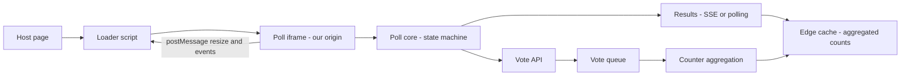

## 1. Requirements exploration

A poll is a tiny UI, so the interviewer is really probing three things: **embedding** (how a component runs safely
and fast on pages you don't control), **write-heavy real-time data** (a hot poll is a burst of writes and a fan-out
of results), and **integrity** (one vote per person without forcing a login). Clarify which surfaces matter; the
embed changes most decisions.

### Functional requirements

- Show question, options (text, optionally an image), poll state (open, closed, scheduled), total votes, end time.
- Vote: single choice (radio) or multiple choice (checkboxes, optional max selections), then submit.
- After voting (or when closed): show results with percentage, bar and count per option; highlight my choice.
- Results visibility: always, after voting, or after close.
- Optionally change my vote until the poll closes.
- Live updates of results while viewing.
- Embeds: a script snippet or iframe; configurable theme (light/dark, accent colour), locale.

### Non-functional requirements

| Concern | Target |
| --- | --- |
| Host page impact | embed adds < 20 KB gzip JS, no render-blocking requests, zero CLS on the host page |
| Time to interactive | widget interactive < 1 s after it scrolls into view on 4G |
| Vote latency | UI acknowledges instantly (optimistic); server confirmation p95 < 500 ms |
| Scale | 100k votes/min on one poll; 1M concurrent viewers across embeds |
| Freshness | live results within ~2–5 s (exact real-time is unnecessary) |
| Integrity | one vote per account; best-effort one per device/browser for anonymous users |
| Accessibility | operable by keyboard and screen readers; results understandable without colour |
| Isolation | host CSS/JS cannot break the widget; widget cannot break or read the host |

### Out of scope

- Poll creation UI and analytics dashboards (mention), ranked-choice voting.

### Clarifying questions

1. Are anonymous votes allowed on embeds, or must users log in?
2. How strict must "one vote per person" be? (Marketing poll vs an official vote with legal weight.)
3. Should the embed be SEO-visible on the host page (question text crawlable)?
4. Do hosts need to listen to events (e.g. "user voted") for their own analytics?

Assume anonymous voting allowed with best-effort dedup, logged-in voting when the user is signed in to our product.

## 2. Architecture / high-level design

### Embed strategy: iframe vs script + Shadow DOM

| Approach | Pros | Cons |
| --- | --- | --- |
| **iframe** (our origin) | strong isolation (CSS, JS, cookies, security); host can't tamper with votes; our CSP | needs height syncing via `postMessage`; extra document cost; third-party cookies blocked/partitioned so login state may not be available; not crawlable as host content |
| **Script + Shadow DOM** (runs in host page) | lighter, inherits fonts, auto-height, SEO-visible if server-rendered by host | shares the host's JS realm: the host (or its other scripts) can read/modify DOM, call our APIs, fake clicks; host global CSS can still leak via inherited properties; host CSP may block us |

**Decision:** a **loader script** that renders a placeholder with reserved height and lazily creates an **iframe**
when the widget nears the viewport. The iframe gives vote integrity and isolation; the loader handles lazy loading,
sizing and host events. For our own product (first-party), use the same core rendered as a native component (no
iframe).

### Components

| Part | Responsibility |
| --- | --- |
| **Loader (`embed.js`)** | tiny (~3 KB): finds `<div data-poll-id>` placeholders, reserves space, lazy-creates iframes, resizes on `postMessage`, exposes host events |
| **Widget app (in iframe)** | renders question/options/results; voting state machine; live updates |
| **Poll core** | framework-agnostic logic (state machine, percentage calculation, formatting) shared with first-party |
| **Vote API** | idempotent vote submission with tokens |
| **Results stream** | SSE or polling of aggregated counts from an edge cache |
| **Integrity service** | voter tokens, rate limits, bot signals |



### Voting flow

1. Widget loads poll definition + current counts from a CDN-cached endpoint (`GET /polls/:id`, `max-age` a few
   seconds).
2. Widget checks whether this voter has already voted (`GET /polls/:id/me`, uncached, with the voter token).
3. User selects and submits. UI immediately shows results with their vote included (optimistic) and a subtle
   "saving" state.
4. Server validates (poll open, token, rate limit, choice validity), writes the vote idempotently, enqueues a count
   increment, returns the voter's recorded choice.
5. Aggregated counts are recomputed/increment-merged and published to the edge every ~1–2 s; viewers pick them up via
   SSE or polling.

## 3. Data model

```ts
interface Poll {
  id: string;
  question: string;
  options: Array<{ id: string; label: string; imageUrl?: string }>;
  kind: 'single' | 'multiple';
  maxSelections?: number;
  status: 'scheduled' | 'open' | 'closed';
  opensAt?: string;
  closesAt?: string;
  resultsVisibility: 'always' | 'after-vote' | 'after-close';
  allowChange: boolean;
  requireLogin: boolean;
}

interface PollResults {
  pollId: string;
  version: number;           // monotonically increasing aggregation version
  totalVotes: number;
  totalVoters: number;       // differs from totalVotes for multiple choice
  counts: Record<string, number>; // optionId -> count
  updatedAt: string;
}

interface MyVote {
  pollId: string;
  optionIds: string[] | null; // null = not voted
  status: 'none' | 'pending' | 'confirmed' | 'failed';
}

type WidgetState =
  | { phase: 'loading' }
  | { phase: 'voting'; selected: string[] }
  | { phase: 'submitting'; selected: string[] }
  | { phase: 'results'; myVote: string[] | null }
  | { phase: 'error'; message: string; retry: () => void };
```

Results are a **separate resource** from the poll definition: the definition is immutable-ish and long-cacheable;
results change constantly and are cached for seconds. Percentages are computed on the client from counts, so the
server only aggregates integers.

Percentage rounding: naive rounding can sum to 99% or 101%. Use the largest-remainder method so displayed percentages
always sum to 100, or show one decimal place.

## 4. Interface definition (API)

### Embed snippet

```html
<div data-poll-id="p_8f3k2" data-theme="auto" data-locale="fr" style="min-height: 320px"></div>
<script async src="https://polls.example.com/embed.js"></script>
```

```ts
// Host-facing events (via the loader, from postMessage)
window.addEventListener('poll:voted', (e: CustomEvent<{ pollId: string; optionIds: string[] }>) => {});
```

### Loader ↔ iframe messages

```ts
type FromFrame =
  | { type: 'poll:resize'; height: number }
  | { type: 'poll:voted'; pollId: string; optionIds: string[] }
  | { type: 'poll:ready'; pollId: string };
type ToFrame = { type: 'poll:theme'; theme: 'light' | 'dark' };
```

Both sides check `event.origin` (the loader accepts only our origin; the frame accepts messages only from its
`parent` and never trusts them for anything security-relevant).

### HTTP

```http
GET  /v1/polls/:id                -> Poll                      (CDN, max-age=60)
GET  /v1/polls/:id/results        -> PollResults               (CDN, max-age=2, stale-while-revalidate=10)
GET  /v1/polls/:id/me             -> MyVote                    (private, no-store)
POST /v1/polls/:id/votes
     Headers: Idempotency-Key: <uuid>, Authorization or voter token cookie
     Body: { "optionIds": ["o2"] }
     200 { "optionIds": ["o2"], "results": PollResults }
     409 { "error": "ALREADY_VOTED", "optionIds": ["o1"] }
     403 { "error": "POLL_CLOSED" }
     429 { "error": "RATE_LIMITED", "retryAfter": 30 }
GET  /v1/polls/:id/stream         -> text/event-stream of PollResults (optional)
```

### First-party component

```ts
interface PollWidgetProps {
  pollId: string;
  initialPoll?: Poll;              // SSR or feed payload to avoid a request
  initialResults?: PollResults;
  live?: boolean | { intervalMs: number };
  onVote?: (optionIds: string[]) => void;
  renderOption?: (opt: Poll['options'][number], state: { selected: boolean; percent?: number }) => React.ReactNode;
  headingLevel?: 2 | 3 | 4;        // fits the host document outline
}
```

## 5. Optimizations and deep dives

### Live results at scale

- **Don't push every vote.** 100k votes/min broadcast to 1M viewers is billions of messages. Aggregate server-side and
  publish a snapshot every 1–2 s; viewers receive at most one update per interval.
- **Polling vs SSE vs WebSocket**: results are one-way and tolerant of a few seconds' delay. **Polling a CDN-cached
  endpoint** (`max-age=2`) scales almost free because the CDN absorbs viewers: 1M viewers polling every 5 s hit the
  origin once per POP per 2 s. SSE adds lower latency for first-party surfaces; WebSockets are overkill.
- Poll only while visible (`IntersectionObserver` + `visibilitychange`), back off when nothing changes, stop when the
  poll closes.
- Apply updates by `version` so an older response arriving late never overwrites newer counts. Merge with the
  optimistic local vote until the server's aggregate includes it (track "my vote pending in aggregate").
- Animate bar widths with `transform: scaleX()` transitions, respecting reduced motion.

### Optimistic voting and failures

- On submit, show results with local counts incremented by one for my options. If the server returns `409
  ALREADY_VOTED`, replace with the server's recorded choice and explain ("You already voted"). On network failure,
  revert to voting state with a retry, keeping the selection.
- `Idempotency-Key` per submission so retries never double count.
- Changing a vote: decrement old options and increment new ones optimistically; the server does the same atomically.

### Integrity and abuse

Perfect "one person, one vote" for anonymous users is impossible; be explicit about the trade-offs:

- **Logged-in users**: dedupe by user ID (strong).
- **Anonymous**: a signed **voter token** in a first-party cookie on our iframe origin. Third-party cookie blocking
  means the iframe gets a **partitioned** cookie (CHIPS, `Partitioned` attribute) per top-level site, so a user can
  vote once per host site rather than once globally; accept that or require login for high-stakes polls. The Storage
  Access API can request unpartitioned access after user interaction, at a UX cost.
- **Rate limits** per IP/subnet, per token, per poll; challenge (invisible CAPTCHA/Turnstile-style) when signals look
  automated; detect bursts from one ASN.
- **Iframe isolation** prevents host scripts from auto-clicking our buttons (they can't reach into a cross-origin
  frame). Set `frame-ancestors` CSP to allowed hosts if the poll owner restricts embedding, and protect against
  clickjacking for sensitive actions.
- Server-side: votes after `closesAt` rejected; option IDs validated; result hiding enforced server-side (don't ship
  counts to the client when `resultsVisibility` says hidden).

### Host page performance

- Loader is `async`, tiny, and does nothing until a placeholder is near the viewport (`IntersectionObserver` with a
  margin). Iframe uses `loading="lazy"`.
- Reserve space with `min-height` (or `aspect-ratio`) on the placeholder; the iframe resizes via `postMessage`
  (observing its own `ResizeObserver`), and growing below the fold doesn't cause visible CLS.
- Widget bundle: vanilla TS or Preact-sized UI; no framework runtime for a 2 KB UI. Inline critical CSS.
- The iframe document is served from a CDN with long cache; poll data is fetched in parallel with the document using
  a preload or inlined at the edge (edge-rendered HTML with the poll embedded removes a round trip).

### Accessibility

- Voting form: `<fieldset>` with `<legend>` containing the question; native radios (single) or checkboxes (multiple),
  each with a `<label>`; a submit button ("Vote"). Native inputs give correct keyboard behaviour (arrow keys within a
  radio group) for free.
- Avoid "click an option to vote immediately" without confirmation: it's error-prone for keyboard and screen reader
  users (arrowing through radios would change selection). If product insists on one-tap voting, use buttons, not
  radios.
- Results: a list where each item reads "Option A, 42 percent, 1,204 votes" — not just a coloured bar. Mark the
  user's choice in text ("Your vote"), not only colour/check icon.
- Announce the transition to results ("Vote recorded. Results: …") via a polite live region; don't announce every
  live update (it would chatter); offer an explicit "refresh" or announce only on significant changes.
- Iframe has a `title` ("Poll: Which feature should we build next?") so screen readers identify it.
- Contrast for bars and text in both themes; RTL support for bar direction.

### i18n

Format numbers and percentages with `Intl.NumberFormat` (`style: 'percent'`), counts with compact notation for
large numbers ("1.2M votes"), relative end time with `Intl.RelativeTimeFormat` ("closes in 3 hours"), plural rules
via `Intl.PluralRules`. The `data-locale` attribute or the host's `lang` decides the locale.

### Observability

Track embed load success by host, time to interactive, vote success/failure rates, 409/429 rates (abuse signals),
results freshness, and CDN hit ratio for results.

## What a lead-level answer adds

- Chooses **iframe isolation for integrity**, explains the cost (cookies partitioned, height syncing), and uses a
  tiny loader to keep host performance intact.
- Designs live results as **aggregated snapshots through a CDN**, not per-vote pushes, with versioned merging.
- Is candid about anonymous vote integrity under third-party cookie restrictions, and maps strictness to product
  stakes (require login for high-stakes polls).
- Shares a framework-agnostic poll core between first-party and embed, avoiding two implementations.
- Treats the embed as a **public API** with versioning: the snippet must keep working for years on pages nobody
  updates.

## Common follow-up questions

**How do you version the embed?** `embed.js` at a stable URL with short cache delegates to a versioned, immutable
bundle; breaking changes go to a new major snippet. Never break old snippets.

**How do you make the question SEO-visible on the host page?** Render fallback content inside the placeholder (the
question and a link to the poll) that the loader replaces; or provide a server-side oEmbed endpoint for hosts.

**What if the CDN serves stale results right after my vote?** The vote response includes fresh results; the client
keeps the highest `version` it has seen and ignores older cached responses.

**How would you handle a poll that closes while the user is choosing?** Server rejects with `POLL_CLOSED`; the
widget switches to final results and explains. The client also schedules a local timer for `closesAt`.

**Why not WebSockets for live results?** One-directional, delay-tolerant data; HTTP caching makes polling or SSE far
cheaper to scale, and works through more corporate proxies.
