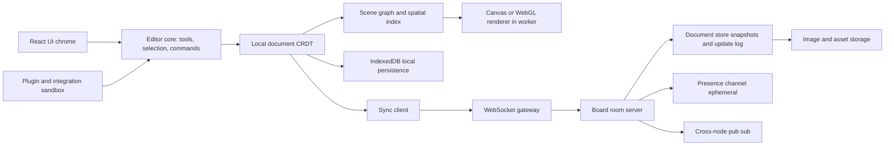

## Framing the problem

A collaborative whiteboard combines three hard problems that usually live in separate products:

1. **A graphics engine**: render tens of thousands of objects at 60 fps with infinite pan and zoom, precise hit testing
   and text layout.
2. **A distributed data system**: many replicas (every open tab) edit the same document concurrently, sometimes
   offline, and must converge to the same state without losing work.
3. **A real-time service**: fan out edits and presence to up to 300 participants per board with low latency, and
   persist durably.

At lead level, the interviewer also wants a fourth: **a platform other teams can extend** (templates, integrations,
AI) without destabilising the core. The answer below spends roughly equal time on rendering, data/sync and the service,
then covers extensibility and the org.

## 1. Requirements exploration

### Functional requirements

- Objects: sticky notes, shapes, connectors (attached to objects, rerouting when they move), free-hand strokes, text,
  images, frames (grouping and presentation), embeds (Jira cards, videos).
- Editing: create, move, resize, rotate, style, group, z-order, multi-select, copy/paste between boards, undo/redo
  **per user**.
- Collaboration: live edits, cursors with names, selections, "follow" a presenter, comments, reactions.
- Offline edits merge on reconnect; version history and restore.
- Permissions: owner, editor, commenter, viewer; link sharing; enterprise SSO, audit log, data residency.

### Non-functional requirements and SLOs

- **Rendering**: 60 fps pan/zoom with 50k objects; under 16 ms per frame budget, ideally under 8 ms on the main thread.
- **Load**: a 50k-object board interactive within 3 s p75.
- **Latency**: remote edits visible within 200 ms p95 in the same region; cursor updates at 10–20 Hz.
- **Concurrency**: 300 participants per board; around 500k concurrent board sessions platform-wide at peak.
- **Durability**: an acknowledged edit is never lost; offline edits survive a browser restart.
- **Availability**: editing continues locally during a server blip; the service is 99.95%.

### Clarifying questions

- Is precise intent preservation needed for text (rich-text co-editing inside a sticky) or is per-field
  last-writer-wins acceptable? (Assume rich text in text objects needs character-level merge.)
- Do viewers need live updates at the same latency as editors? (Assume yes, but they never send edits.)
- Are mobile and tablets in scope? (Assume web first, touch and pen support required.)

## 2. Architecture



### Client layers

- **UI chrome** (React): toolbars, panels, menus, dialogs. React does **not** render board objects; reconciling 50k
  objects through React would blow the frame budget.
- **Editor core** (framework-free TypeScript): tools (select, draw, connector), input handling (pointer events with
  coalesced events for smooth strokes), commands, undo/redo, selection.
- **Document**: a CRDT replica, the source of truth for board content.
- **Scene graph**: derived render data (resolved styles, transforms, text layout caches) plus a spatial index (R-tree or
  quadtree) for culling and hit testing.
- **Renderer**: Canvas 2D for simplicity, or WebGL/WebGPU for scale; rendering can run in a worker with
  `OffscreenCanvas` so main-thread work (input, UI) does not compete with drawing.
- **Sync client**: sends local updates, applies remote ones, handles reconnect and offline queue.

### Server layers

- **Gateway**: terminates WebSockets, authenticates, routes the connection to the board's room.
- **Room server**: one authoritative process per active board (sharded by board ID with consistent hashing). It holds
  the board document in memory, validates and applies updates, broadcasts to participants, and persists.
- **Document store**: periodic snapshots plus an append-only update log (for example, Postgres or a key-value store for
  the log, object storage for snapshots).
- **Presence**: ephemeral, not persisted; relayed through the room with throttling.

## 3. Data model and contracts

### Board document

Objects are stored as a map keyed by object ID, not an array, so concurrent creates never conflict on position.

```ts
type ObjectId = string; // client-generated, globally unique

interface BoardObjectBase {
  id: ObjectId;
  type: 'sticky' | 'shape' | 'connector' | 'stroke' | 'text' | 'image' | 'frame' | 'embed';
  x: number; y: number; width: number; height: number; rotation: number;
  parentId: ObjectId | null;   // frame or group membership
  zIndex: string;              // fractional index, e.g. "a0V", allows inserts between any two without renumbering
  style: Record<string, string | number>;
  createdBy: string;
  locked?: boolean;
}

interface StickyNote extends BoardObjectBase { type: 'sticky'; text: RichText /* CRDT text */; }
interface Connector extends BoardObjectBase {
  type: 'connector';
  from: { objectId: ObjectId; anchor: 'auto' | 'top' | 'right' | 'bottom' | 'left' } | { x: number; y: number };
  to:   { objectId: ObjectId; anchor: 'auto' | 'top' | 'right' | 'bottom' | 'left' } | { x: number; y: number };
}
interface Stroke extends BoardObjectBase { type: 'stroke'; points: Float32Array; pressure?: Float32Array; }
```

Design choices:

- **Fractional indexing** for z-order: moving an object to front writes one key instead of reindexing thousands.
- **Per-property last-writer-wins registers** for geometry and style (two users moving the same sticky: one wins,
  which matches user expectations), and a **sequence CRDT** for rich text inside objects.
- **Strokes are immutable** once finished; while drawing, points stream as presence-like ephemeral data, then the final
  stroke is committed as one object. This avoids thousands of CRDT ops per stroke.
- **Images** are uploaded to asset storage; the document holds a content-hash reference.

### Sync protocol

Using a CRDT library such as Yjs or Automerge, updates are binary-encoded deltas.

```ts
// client -> server
type ClientMsg =
  | { t: 'hello'; boardId: string; stateVector: Uint8Array; protocol: 3 }
  | { t: 'update'; clientSeq: number; update: Uint8Array }
  | { t: 'presence'; cursor?: { x: number; y: number }; selection?: ObjectId[]; viewport?: Rect };

// server -> client
type ServerMsg =
  | { t: 'sync'; missing: Uint8Array }                       // updates the client lacks
  | { t: 'update'; from: string; update: Uint8Array }
  | { t: 'ack'; clientSeq: number }
  | { t: 'presence'; peers: Record<string, PeerPresence> }   // batched, throttled
  | { t: 'error'; code: 'FORBIDDEN' | 'INVALID_UPDATE' | 'BOARD_LOCKED'; message: string };
```

On connect, the client sends its **state vector** (what it already has); the server replies with exactly the missing
updates, and the client sends back what the server lacks (offline edits). This handshake is how offline merge works.

## 4. Interfaces

### Editor core API (used by the UI and by other teams)

```ts
interface Editor {
  readonly store: {
    get(id: ObjectId): BoardObject | undefined;
    query(rect: Rect): BoardObject[];                     // spatial index
    subscribe(cb: (changes: ChangeSet) => void): () => void;
  };
  transact(label: string, fn: (tx: Transaction) => void): void;  // atomic, one undo step
  undo(): void;
  redo(): void;
  select(ids: ObjectId[]): void;
  setTool(tool: ToolId): void;
  camera: { x: number; y: number; zoom: number; zoomToFit(ids?: ObjectId[]): void };
  registerObjectType<T extends BoardObjectBase>(def: ObjectTypeDefinition<T>): void;
  registerTool(def: ToolDefinition): void;
}

interface Transaction {
  create<T extends BoardObject>(obj: Omit<T, 'id' | 'zIndex'> & Partial<Pick<T, 'zIndex'>>): ObjectId;
  update(id: ObjectId, patch: Partial<BoardObject>): void;
  delete(id: ObjectId): void;
}
```

Undo is **per user**: each client tracks its own transactions and inverts only its own changes (Yjs `UndoManager`
with tracked origins does this), so undo never removes a collaborator's work.

### Plugin API (sandboxed)

Third-party and internal integration code runs in a sandboxed iframe or worker, talking to the editor over a
message-based API with explicit permissions (`read:board`, `write:selection`, `network:jira.atlassian.com`). Plugins
never get direct access to the document object or DOM.

## 5. Deep dives and trade-offs

### Rendering 50k objects at 60 fps

- **Culling**: query the spatial index for objects intersecting the viewport (plus margin); typically a few hundred are
  drawn even on huge boards.
- **Level of detail**: at low zoom, draw stickies as coloured rectangles without text; replace small text with grey
  bars; simplify strokes. Text layout is the most expensive part; cache measured layouts per object and zoom bucket.
- **Tile or layer caching**: render static content into cached bitmaps (tiles at discrete zoom levels) and redraw only
  dirty regions; objects being dragged go on a separate overlay layer.
- **WebGL vs Canvas 2D**: Canvas 2D is simpler and good for a few thousand visible objects; WebGL (or WebGPU where
  available) batches thousands of draws and handles zoom transforms cheaply, at the cost of implementing text and
  vector rendering yourself (SDF text, tessellation). Many production whiteboards start with Canvas 2D and move hot
  paths to WebGL.
- **Off the main thread**: `OffscreenCanvas` in a worker keeps rendering smooth while React updates panels; input
  still arrives on the main thread and is forwarded.
- **Hit testing**: spatial index for candidates, then precise geometry tests; for strokes, distance to polyline with a
  tolerance scaled by zoom.
- **Accessibility**: canvas content is invisible to assistive tech, so maintain a parallel, virtualised accessible
  tree (an off-screen list of objects in reading order, with roles and labels) and keyboard navigation between objects.

### CRDT vs OT vs server-authoritative

| Approach | How | Fit |
| --- | --- | --- |
| **Operational transformation** | Central server transforms concurrent ops (Google Docs) | Great for linear text; complex for tree/graph data; offline merges are hard |
| **Server-authoritative LWW per property** | Server orders updates; clients apply optimistically and reconcile (Figma's published approach) | Simple, efficient for object properties; needs extra work for text and long offline periods |
| **CRDT** (Yjs, Automerge, Loro) | Replicas merge deterministically without a central sequencer | Strong offline story, mature libraries; metadata overhead and tombstones need compaction |

**Recommendation:** a CRDT document (Yjs is the most battle-tested in production web apps) **plus** a server that
still acts as the authority for **permissions and validation**. The CRDT handles merge; the room server rejects updates
from viewers, enforces object limits and schema validity, and is the durable checkpoint. A custom server-ordered LWW
model is a valid alternative if the team has the expertise and offline is less important; it is leaner on memory.

Semantic conflicts still need product rules on top of the CRDT: one user deletes a frame while another adds a sticky
inside it (keep the sticky, move it to the board root); a connector's target is deleted (convert the endpoint to a free
point).

### Presence at 300 participants

Presence is the hidden scaling problem: 300 cursors at 20 Hz is 6,000 messages/s inbound and, naively, 1.8 million
outbound per second for one board. Mitigations:

- **Throttle and batch**: clients send cursor updates at most every 50 ms; the room broadcasts batched presence frames
  every 50–100 ms.
- **Interest management**: only send cursors of peers whose cursor is inside or near the recipient's viewport; above
  a threshold (say 50 active cursors), show an aggregate count and only the nearest or "speaking" cursors.
- **Viewer mode**: viewers do not send cursors by default.
- **Smooth on the receiver**: interpolate cursor positions so 10 Hz looks fluid.
- Presence is never persisted and can be dropped under load before document updates are.

### The multiplayer service

- **One room per board** on a single node gives a natural ordering point and in-memory state; consistent hashing
  routes connections; if a node dies, the room reloads from snapshot + log on another node and clients reconnect with
  their state vectors, so nothing acknowledged is lost.
- **Persistence**: append each accepted update to the log before acknowledging; compact into snapshots periodically
  (every N updates or minutes) and garbage-collect CRDT tombstones during compaction.
- **Hot boards**: a 300-person workshop is still one room; a single modern node can handle that comfortably if
  presence is optimised. For very large read audiences (10k viewers of a town hall), fan out through a tier of relay
  nodes that only forward.
- **Regionality**: rooms run in the board's data-residency region; latency for remote participants is higher but data
  stays in region, which enterprise customers require.
- **Build vs buy**: Liveblocks, PartyKit (Cloudflare Durable Objects), Y-Sweet, Hocuspocus (Yjs server) or Ably can
  provide the realtime layer. Buying accelerates an MVP; at 5M MAU with residency and audit needs, owning the room
  service is common, possibly built on Durable Objects-style primitives.

### Loading large boards

- Server sends a compact snapshot (binary CRDT state) rather than replaying history; the client hydrates the document
  in a worker, then builds the spatial index incrementally.
- Render a **cached preview image** of the board's last state immediately so users see something in under a second,
  then switch to live rendering.
- Load images lazily by visibility and zoom level, with multiple resolutions per asset.
- Local IndexedDB cache of the board lets reopening be near-instant, followed by a state-vector sync.

### Offline and reconnect

Local updates are persisted to IndexedDB (the CRDT's provider) before being sent. On reconnect, the state-vector
handshake exchanges missing updates both ways. If a user's permission was revoked while offline, the server rejects
their updates; the client must tell the user clearly and offer to export or duplicate their offline changes rather
than silently discarding them.

### Security and permissions

Authorisation is checked at connection (board role) and per update (viewers and commenters cannot change objects;
locked objects reject edits). Embedded content (Jira cards, URLs) renders in sandboxed iframes or as server-fetched
previews; user-provided URLs are validated to prevent SSRF in the preview service. Audit logs record board-level
actions (share, export, permission changes), not every cursor move.

## Org and people considerations

- **Team topology**: a **core editor team** (document model, editor core, renderer, undo), a **multiplayer infra team**
  (rooms, persistence, presence), and **stream-aligned teams** (templates, integrations, AI) building on public editor
  and plugin APIs.
- **Extension contract**: other teams extend through `registerObjectType`, `registerTool` and the sandboxed plugin
  API, never by editing core files. Each object type ships a schema with a version and a migration function, so old
  boards keep opening.
- **Schema migrations**: document schema versions are stored in the board; clients older than the board's schema open
  in read-only mode and prompt a refresh. Migrations are lazy (on open) and idempotent.
- **RFCs** for document schema changes, sync protocol versions and plugin permissions; protocol versions are negotiated
  in the `hello` message.
- **Performance ownership**: the core team owns a performance lab (fixture boards of 1k, 10k, 50k objects; scripted
  pan/zoom; frame-time budgets in CI) and can block releases that regress it.
- **AI team specifics**: AI-generated content goes through the same transactions (one undo step, attributed to the
  invoking user), and rate limits prevent an agent from flooding a room with updates.

### Rollout and success metrics

Ship the CRDT engine behind a flag on new boards first, migrate existing boards lazily on open with a fallback path,
and run a dual-write comparison during the transition.

- Frame time p95 during pan/zoom on large boards; time to interactive for board open.
- Edit propagation latency p95; reconnect success rate; conflicts requiring product rules.
- Data loss incidents (target zero); snapshot and compaction lag.
- Room server cost per concurrent user; presence bandwidth per board.
- Engagement: boards with 2+ concurrent editors, session length, workshop success (300-participant sessions without
  degradation).

## What a lead-level answer adds

- Decomposes into **graphics, data and service** problems and keeps React out of the hot rendering path.
- Picks a **sync model with clear reasoning** (CRDT plus authoritative server for permissions) and addresses semantic
  conflicts the CRDT cannot.
- Identifies **presence as the real scaling bottleneck** at 300 participants and applies interest management.
- Covers **durability mechanics**: log before ack, snapshots, compaction, room failover with state vectors.
- Designs an **extension model and schema-migration strategy** so multiple teams can build safely, and backs it with a
  performance lab and ownership.

## Common follow-up questions

**Why not let React render the objects with virtualization?**
Virtualization helps lists, but a canvas board needs per-frame transforms of hundreds of objects during pan and zoom.
React reconciliation and DOM layout per frame cannot hit 60 fps at that scale; a retained scene graph drawn to canvas
can. DOM overlays are still useful for the object being edited (text editing with native IME support).

**How do you do per-user undo with a CRDT?**
Track transactions by origin (the local client) and record inverse operations; undo applies the inverse as a new
change. If someone else has since modified the same property, the undo restores your previous value only if it does not
override their newer change, a product decision documented explicitly.

**How do you handle CRDT document growth?**
Periodic compaction on the server: create a new snapshot without history older than the retention window and garbage
collect tombstones. Version history is preserved separately as named checkpoints.

**What happens when the room node crashes mid-workshop?**
Clients reconnect with exponential backoff and jitter to the new owner of the board, which loads the latest snapshot
and replays the log. Clients resend unacknowledged updates; CRDT idempotence makes duplicates harmless. Users see a
brief "reconnecting" banner and keep editing locally meanwhile.

**How would you test convergence?**
Property-based tests that apply random concurrent operations across simulated replicas in random orders and assert
identical final state; fuzzing the protocol with dropped and duplicated messages; and long-running soak tests with
bots in real rooms.
