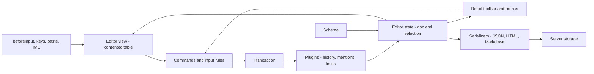

## 1. Requirements exploration

A rich text editor is the hardest "component" most front-end teams ever own, because the browser's built-in editing
(`contenteditable`) is powerful but unpredictable. The interview tests whether you understand **why modern editors
keep their own document model**, how input flows through it, and how to expose an extensible API without letting
consumers break invariants.

### Functional requirements

- Block nodes: paragraph, heading (1–3), bulleted/numbered list (nested), blockquote, code block, image, horizontal
  rule, custom embeds.
- Inline marks: bold, italic, underline, strikethrough, code, link. Inline nodes: mention, emoji.
- Toolbar reflecting the current selection's state; keyboard shortcuts (`Mod+B`, `Mod+K` for links…).
- Input rules: `## ` → heading, `- ` → list, `**text**` → bold, ` ``` ` → code block.
- Paste: sanitised HTML from Word/Docs/web, plain text, Markdown, images from clipboard; drag-and-drop images.
- Undo/redo with sensible grouping.
- Placeholder, read-only mode, character limit, controlled value for forms.
- Feature flags per instance: a chat composer may allow only bold/italic/links/mentions.

### Non-functional requirements

| Concern | Target |
| --- | --- |
| Typing latency | keystroke to paint < 16 ms on a 10k-word document |
| Bundle | core < 40 KB gzip; features tree-shakeable; heavy pieces (syntax highlighting, tables) lazy-loaded |
| Correctness | the stored document always validates against the schema; no invalid nesting after any edit or paste |
| Security | no XSS via paste, links or stored content |
| Accessibility | WCAG 2.2 AA; screen reader editing works in NVDA, JAWS, VoiceOver; toolbar per APG |
| Input methods | IME composition, mobile autocorrect, dictation, spellcheck all work |
| Browsers | evergreen desktop + iOS Safari + Android Chrome |

### Out of scope

- Real-time collaboration (follow-up), comments, tables with merged cells, page layout/pagination.

### Clarifying questions

1. What is the storage format consumers need: HTML, Markdown or structured JSON? Do non-web clients render it?
2. Do we build on an existing engine (ProseMirror/Tiptap, Lexical, Slate) or from scratch? (The answer is almost
   always "on an engine"; the question is which.)
3. Maximum document size? Comments are tiny; CMS articles can be long.
4. Is collaboration on the roadmap? (Influences engine choice: ProseMirror and Lexical both have Yjs bindings.)

Assume structured JSON storage, build on an engine, collaboration later.

## 2. Architecture / high-level design

### Why not just `contenteditable` + `execCommand`?

- `document.execCommand` is deprecated and produces different HTML in different browsers (`<b>` vs
  `<strong>` vs `<span style="font-weight:bold">`), nested garbage after repeated toggling, and no schema.
- The DOM is a poor source of truth: you cannot easily answer "is the selection bold?" or enforce "lists contain
  only list items".
- But `contenteditable` gives native caret movement, selection, spellcheck, IME, autocorrect, dictation and
  accessibility, which you cannot rebuild well.

So model-based editors use `contenteditable` as an **input surface** and treat the DOM as a **render** of an
immutable or controlled document model:

| Engine | Model | Notes |
| --- | --- | --- |
| **ProseMirror** (Tiptap wraps it) | immutable tree with a strict schema; changes are *steps* grouped in *transactions*; positions are integer offsets | very robust, schema-first, mature collab story; steeper learning curve |
| **Lexical** (Meta) | mutable node tree inside `editor.update()` closures, double-buffered editor state, own reconciler | small core, good performance and React integration, plugin-oriented |
| **Slate** | JSON tree mirroring the DOM shape, operations, React rendering | very flexible and React-native; historically more edge-case bugs on mobile/IME |
| **Quill** | Delta format (ops) over a linear document | simple, good for basic formatting; less flexible for nested structures |

**Decision:** build the design-system component on **ProseMirror via Tiptap** (or Lexical if the organisation
prefers its React model); the design system adds the schema, UI, plugin conventions, sanitisation and serialisers.
I will describe the architecture generically so it holds for either.

### Layers

| Layer | Responsibility |
| --- | --- |
| **Schema** | node and mark types, allowed content, attributes, parse rules (HTML → model) and render rules (model → DOM) |
| **State** | document + selection + stored marks + plugin state; immutable snapshots |
| **Transactions** | the only way to change state; carry steps, metadata (`addToHistory`, `origin`) |
| **View** | renders state to the `contenteditable` DOM, listens to `beforeinput`, keyboard, composition, paste, mutation observer; maps DOM selection ↔ model positions |
| **Plugins/extensions** | keymaps, input rules, paste transforms, decorations, node views, commands |
| **React UI** | toolbar, bubble menu, link popover, mention picker; reads state via subscriptions, dispatches commands |
| **Serialisers** | JSON (canonical), HTML (render/email), Markdown and plain text (notifications, search) |



### Input flow

1. User presses a key. The browser fires `keydown` (keymaps get first chance: `Mod+B` → `toggleMark('bold')`), then
   `beforeinput` with an `inputType` (`insertText`, `deleteContentBackward`, `insertParagraph`,
   `insertFromPaste`…).
2. For handled types, the view calls `preventDefault()` and dispatches a transaction; state updates; the view
   re-renders only changed nodes and restores the selection.
3. For unhandled or uncancellable cases (IME composition, some Android input, spellcheck replacement), the browser
   mutates the DOM; a `MutationObserver` reads the change, diffs it against the expected render, and converts it
   into a transaction. This "let the browser do it, then read back" path is what makes IME work.

## 3. Data model

```ts
// Canonical stored format: versioned JSON tree
interface StoredDocument {
  schemaVersion: 3;
  doc: DocNode;
}

type DocNode = { type: 'doc'; content: BlockNode[] };

type BlockNode =
  | { type: 'paragraph'; content?: InlineNode[] }
  | { type: 'heading'; attrs: { level: 1 | 2 | 3 }; content?: InlineNode[] }
  | { type: 'bulletList' | 'orderedList'; attrs?: { start?: number }; content: ListItemNode[] }
  | { type: 'blockquote'; content: BlockNode[] }
  | { type: 'codeBlock'; attrs: { language: string | null }; content?: TextNode[] }
  | { type: 'image'; attrs: { src: string; alt: string; width?: number; uploadId?: string } }
  | { type: 'embed'; attrs: { kind: string; id: string } };

type ListItemNode = { type: 'listItem'; content: BlockNode[] };

type InlineNode =
  | TextNode
  | { type: 'mention'; attrs: { id: string; label: string } }
  | { type: 'hardBreak' };

type TextNode = { type: 'text'; text: string; marks?: Mark[] };

type Mark =
  | { type: 'bold' | 'italic' | 'underline' | 'strike' | 'code' }
  | { type: 'link'; attrs: { href: string; rel?: string } };
```

Why JSON over HTML or Markdown as the canonical format:

- **HTML** is ambiguous (many ways to represent the same thing) and dangerous to store raw; every renderer must
  sanitise.
- **Markdown** cannot represent everything (underline, mentions, embeds) without extensions, and round-trips lose
  information.
- **JSON** validated against a schema is unambiguous, versionable (migrations by `schemaVersion`) and renderable by
  any client. Derive HTML/Markdown/plain text on the server for emails, previews and search.

Editor runtime state:

```ts
interface EditorState {
  doc: DocNode;
  selection: { anchor: number; head: number } | { type: 'node'; pos: number };
  storedMarks: Mark[] | null;  // marks to apply to the next typed text (after Mod+B with an empty selection)
  plugins: Record<string, unknown>; // history stacks, mention query, decorations
}
```

## 4. Interface definition (API)

### Component

```ts
interface RichTextEditorProps {
  /** Controlled: the editor emits JSON; parents should not re-feed it on every keystroke */
  value?: StoredDocument;
  defaultValue?: StoredDocument | string; // string = HTML or Markdown to import
  onChange?: (doc: StoredDocument, meta: { origin: 'user' | 'api' }) => void;
  /** Feature set: only these extensions are loaded, the schema is built from them */
  extensions: EditorExtension[];
  placeholder?: string;
  readOnly?: boolean;
  maxLength?: number;
  autoFocus?: boolean | 'start' | 'end';
  'aria-label'?: string;
  'aria-labelledby'?: string;
  'aria-describedby'?: string;
  onImageUpload?: (file: File, signal: AbortSignal) => Promise<{ src: string; uploadId: string }>;
  mentionSource?: (query: string, signal: AbortSignal) => Promise<Array<{ id: string; label: string }>>;
  toolbar?: 'fixed' | 'bubble' | 'none' | ((api: EditorApi) => React.ReactNode);
}

interface EditorApi {
  getJSON(): StoredDocument;
  getText(): string;
  isEmpty(): boolean;
  focus(position?: 'start' | 'end'): void;
  chain(): CommandChain;          // editor.chain().focus().toggleBold().run()
  can(): CommandChain;            // dry run: is this command applicable? (drives disabled state)
  isActive(name: string, attrs?: Record<string, unknown>): boolean;
  on(event: 'update' | 'selectionUpdate' | 'focus' | 'blur', cb: () => void): () => void;
}
```

Expose `EditorApi` via `ref` or a `useEditor()` hook. A **headless** variant (`useRichTextEditor()` returning the
API and an `EditorContent` element) lets teams build their own toolbar.

The `value` prop deserves a warning in the docs: making the editor fully controlled by re-parsing the document on
every change destroys selection and is slow. Treat `value` as "reset when this identity changes" (or compare a
version), and use `onChange` for persistence (debounced).

### Extension API

```ts
interface EditorExtension {
  name: string;
  nodes?: Record<string, NodeSpec>;
  marks?: Record<string, MarkSpec>;
  keymap?: Record<string, Command>;
  inputRules?: InputRule[];
  pasteRules?: PasteRule[];
  commands?: Record<string, (...args: any[]) => Command>;
  nodeView?: Record<string, React.ComponentType<NodeViewProps>>; // React-rendered embeds
  plugins?: Plugin[];
}
```

A product team adds a "task" embed by registering a node spec plus a React node view; the schema validates it and
serialisers get a hook to render it to HTML/Markdown.

## 5. Optimizations and deep dives

### Selection and position mapping

The model uses integer positions (ProseMirror) or node keys + offsets (Lexical). The view keeps a mapping from model
nodes to DOM nodes so it can translate `window.getSelection()` to model positions and back. Decorations (spellcheck,
search highlights, mention query highlight) are rendered as wrappers that the mapping knows to skip. Every step can
**map** positions forward, which is how decorations, remote cursors and pending link popovers stay attached to the
right place after edits.

### IME and mobile

- During composition (`compositionstart` → `compositionend`), do not re-render the composing text node or move the
  selection; the IME owns it. Apply the final text as a transaction afterwards.
- Android Chrome often reports `keydown` with key code 229 and fires `beforeinput` events that are not cancellable
  for some input types; rely on the mutation read-back path.
- iOS autocorrect replaces words via `insertReplacementText`; handle it as a normal replace transaction.
- Test matrix must include real devices: emulators do not reproduce IME behaviour faithfully.

### Paste pipeline

1. Read `text/html` if present, else `text/plain`, else files (images).
2. Pre-clean known sources: Word's `mso-` styles and conditional comments, Google Docs' wrapping `<b id="docs-internal-guid-…">`.
3. Parse HTML with `DOMParser` into a detached document (never insert into the live page), then run schema **parse
   rules**: map `<strong>`, `<b>`, `font-weight: 700` to the bold mark; `<h1>` to heading; drop anything the schema
   does not know (scripts, iframes, styles, event handlers).
4. Fit into the current context (pasting a list into a list item merges levels) and respect enabled extensions (a
   chat composer drops headings into paragraphs).
5. Plain text that looks like Markdown can optionally be converted; URLs pasted over a selection become links.

### Security

- Schema-based parsing is the main XSS defence: unknown tags and attributes cannot exist in the model.
- Validate `href` and `src` protocols (allow `http:`, `https:`, `mailto:`; reject `javascript:`, `data:` for links);
  add `rel="noopener noreferrer nofollow"` for external links.
- Server-side, validate stored JSON against the same schema (shared package) and render HTML with escaping. Never
  trust the client's HTML output.
- Images: upload through the app's upload service; don't hotlink arbitrary URLs in emails.

### Undo/redo

History records transactions, grouping consecutive typing within ~500 ms into one step and splitting on selection
jumps or formatting commands. Transactions tagged `addToHistory: false` (remote collab changes, programmatic
normalisation) are excluded. Undo of a paste is a single step.

### Performance

- The view updates only changed nodes; React renders only the toolbar and node views. Never wrap each paragraph in
  a React component that re-renders on every keystroke.
- Toolbar state (`isActive`, `can`) is computed on `selectionUpdate`, batched per frame.
- Lazy-load heavy extensions: code-block syntax highlighting (highlight in a worker or with a small grammar set),
  tables, emoji data.
- For very long documents, `content-visibility: auto` on top-level blocks reduces layout cost without removing DOM.
- `onChange` serialisation to JSON is O(document); debounce it or serialise lazily on save.

### Accessibility

- The editable root: `role="textbox"`, `aria-multiline="true"`, an accessible name, and `aria-describedby` for help
  text and the character count. Semantic HTML output (`h2`, `ul`, `blockquote`, `code`) so screen readers announce
  structure while reading.
- Toolbar: APG toolbar pattern (`role="toolbar"`, one tab stop, arrow keys between buttons, `aria-pressed` for
  toggle marks), plus `Alt+F10` (common convention) or a documented shortcut to move focus from the editor to the
  toolbar. Every action also has a keyboard shortcut, listed in a help dialog.
- Mention picker: combobox semantics — the editor is the input, `aria-activedescendant` points at the active
  option, with `aria-controls`/`aria-expanded` set on the editable root while open.
- Announce formatting toggles that are not visible to screen reader users ("bold on") through a polite live region,
  sparingly.
- Placeholder is visual only (CSS `::before` with `data-placeholder`), with the real label coming from
  `aria-label`/`aria-labelledby`.

### Testing

- Unit tests on commands and transforms against model documents (fast, no DOM).
- Paste fixtures captured from Word, Google Docs, Notion, Confluence and common websites, with snapshot assertions of
  the resulting JSON.
- Browser tests (Playwright) for selection, IME (Chromium supports composition events via CDP), and the
  toolbar; manual screen reader and mobile device passes before releases.
- Fuzz tests: random sequences of commands produce schema-valid documents.

## What a lead-level answer adds

- Explains **why** the model-based architecture exists, and still uses `contenteditable` for native input, IME and
  accessibility.
- Makes the **stored format** a deliberate, versioned API with migrations, shared validation and server-side
  rendering, because content outlives the editor.
- Designs extensibility so product teams cannot violate invariants: schemas, commands and node views instead of DOM
  access.
- Recommends building on ProseMirror/Tiptap or Lexical and spends the team's effort on integration, security and
  a11y; writing an editing engine is a multi-year commitment.
- Plans for collaboration later by choosing an engine with a mature Yjs binding and keeping all changes in
  transactions.

## Common follow-up questions

**How would you add real-time collaboration?** Bind the editor state to a CRDT (Yjs `XmlFragment` via
`y-prosemirror` or Lexical's Yjs plugin) or use ProseMirror's central-authority collab module; scope undo to local
origin; render remote cursors as decorations.

**How do you implement a character limit?** A plugin that filters transactions which would increase the length
beyond `maxLength` (counting text plus a weight for mentions/embeds) and exposes the count for an `aria-live`
counter. Pasted content gets truncated rather than rejected.

**How would you migrate stored content from HTML to JSON?** Parse each document server-side through the same schema
(e.g. headless ProseMirror with a DOM implementation), store JSON with `schemaVersion`, keep the HTML for rollback, and
compare rendered output on a sample.

**Why are mentions inline nodes rather than marks?** A mention is atomic: the caret should not enter it, deleting
removes it entirely, and it carries an ID. Marks apply to arbitrary text runs.

**Controlled vs uncontrolled for forms?** Uncontrolled with `defaultValue` + `onChange` (debounced), plus an
imperative `setContent` for resets. Fully controlled editors fight the browser's selection.
