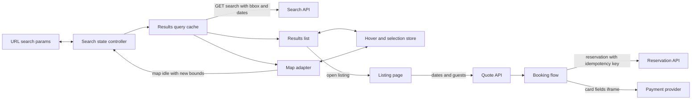

## 1. Requirements exploration

A stays marketplace combines three hard front-end problems: a **search page whose state is mostly in the URL and
partly in a map**, **date handling across time zones**, and a **booking flow that must be correct under
concurrency** (two people trying to book the same nights). Say early that these are where you'll spend your time.

### Functional requirements

- **Search bar**: destination autocomplete, date range picker (check-in / check-out, flexible dates as a stretch),
  guest counts (adults, children, infants, pets).
- **Results page**: listing cards (photo carousel, title, rating, total price for the dates) in a list, plus a map
  with price markers. Hovering a card highlights its marker and vice versa. Panning/zooming the map re-searches
  within the visible area. Filters and sort.
- **Listing page**: gallery, description, amenities, reviews, host, location (approximate before booking),
  availability calendar with blocked dates and minimum-stay rules, price breakdown (nightly rate × nights,
  cleaning fee, service fee, taxes).
- **Booking**: review trip details, choose payment, agree to house rules, submit; instant book confirms
  immediately, otherwise "request sent".
- Wishlist (save listings), compare later.

### Non-functional requirements

| Concern | Target |
| --- | --- |
| Results LCP | < 2.5 s p75 mobile; first card photo is the LCP element |
| Map interaction | 60 fps pan/zoom; results refresh < 800 ms after the map stops moving |
| INP | < 200 ms for filters, date picks, marker clicks |
| SEO | city/region landing pages and listing pages server-rendered and indexable |
| Correctness | displayed total equals charged total; no double booking (server-enforced) |
| i18n | 60+ locales, 40+ currencies, RTL |
| Accessibility | WCAG 2.2 AA, including the date picker and map alternatives |

### Out of scope

Host tools (calendar management, pricing), messaging, experiences, search ranking and pricing algorithms.

### Clarifying questions

1. Does the price shown in search include all fees (total price display is now a legal requirement in some markets)?
2. Instant book only, or also request-to-book with host approval?
3. Which map provider? (Google Maps, Mapbox, or open-source MapLibre with own tiles — cost and licensing matter.)
4. How fresh must availability be in search results? (A few minutes stale is OK; the listing page and booking must be
   live.)
5. Do we need flexible-date search ("a weekend in June")?
6. Is there a hold mechanism on dates during checkout?

## 2. Architecture / high-level design

### Rendering strategy

| Route | Strategy |
| --- | --- |
| `/s/:place/homes?checkin&checkout&adults&...` | SSR (first page of results + map placeholder), CDN cache when no dates are set, hydrate; client-side updates afterwards |
| `/rooms/:id` | SSR; static parts cached; availability, price and calendar fetched client-side (date-dependent) |
| `/book/:id?...` | CSR/SSR private, no caching, minimal third-party scripts |
| Landing pages (`/paris`) | statically generated, revalidated daily |

The **map is client-only** and heavy (map SDK + WebGL). Render the list first, show a static map image or a
placeholder, then load the map library on idle or when the map pane becomes visible (on mobile it's behind a "Map"
toggle, so it may never load). This alone can save 200–500 KB of JS from the critical path.

### Component tree (search)

```
<SearchPage>
  <SearchBar>                      // location combobox, date range picker, guests popover
  <FilterBar />                    // chips + "Filters" dialog
  <SplitLayout>
    <ResultsPane>
      <ResultsHeader />            // "300+ stays in Lisbon", sort
      <ListingGrid>
        <ListingCard />            // carousel, wishlist heart, rating, price
      <Pagination />
    <MapPane>                      // lazy
      <MapView />                  // provider adapter
      <PriceMarker />              // clustered at low zoom
      <MapListingPreview />        // card popup on marker click
      <SearchAsIMoveToggle />
  <MobileMapToggle />
```

### Modules

- **Search state controller**: parses/serializes the URL; single source of truth for query parameters.
- **Results data layer**: query cache keyed by the normalized search params; aborts superseded requests.
- **Map adapter**: wraps the provider SDK behind a small interface (`setBounds`, `setMarkers`, `onIdle`,
  `highlight(id)`) so we can switch providers and test without WebGL.
- **Hover/selection store**: tiny shared store for `hoveredListingId` / `selectedListingId`, outside React context
  to avoid re-rendering the whole tree on every hover.
- **Pricing/booking client**: quotes, holds, and reservation submission.



## 3. Data model

### URL is the primary client state

```
/s/Lisbon--Portugal/homes?checkin=2025-07-10&checkout=2025-07-14&adults=2&children=1
  &price_min=80&price_max=250&amenities=wifi,kitchen&room_type=entire_home
  &ne_lat=38.75&ne_lng=-9.10&sw_lat=38.69&sw_lng=-9.20&zoom=13&cursor=...
```

Everything that changes the result set lives in the URL: shareable links, back/forward, SSR, analytics. UI-only state
(hovered card, open popovers, carousel index) stays in memory. Use `replaceState` for map moves (don't flood history
with every pan) and `pushState` for deliberate changes (new destination, dates, filters).

### Dates: calendar dates, not instants

Check-in "10 July" means 10 July **in the listing's location**, regardless of where the guest is. Represent stay dates
as `YYYY-MM-DD` strings (or `Temporal.PlainDate` where available / polyfilled), never as `Date` objects at midnight
UTC — a `new Date('2025-07-10')` parsed as UTC midnight displays as 9 July for a user in New York. Times like
"check-in after 15:00" are local wall-clock times in the listing's time zone (stored as `HH:mm` + IANA zone).

### Shapes

```ts
type ID = string;
type PlainDate = string;                 // "2025-07-10"
type Money = { amount: string; currency: string };

interface SearchParams {
  placeId?: ID;
  bounds?: { ne: [number, number]; sw: [number, number] };
  checkin?: PlainDate;
  checkout?: PlainDate;
  guests: { adults: number; children: number; infants: number; pets: number };
  filters: { priceMin?: number; priceMax?: number; roomTypes: string[]; amenities: string[]; instantBook?: boolean };
  sort: 'recommended' | 'price_asc' | 'rating';
  cursor?: string;
}

interface ListingSummary {
  id: ID;
  title: string;
  coordinates: { lat: number; lng: number };   // fuzzed/approximate until booked
  photos: { url: string; width: number; height: number; alt: string }[];
  rating?: { average: number; count: number };
  displayPrice: { total?: Money; perNight: Money; nights?: number }; // total when dates are known
  badges: ('superhost' | 'guest_favourite' | 'instant_book')[];
}

interface Availability {
  listingId: ID;
  timeZone: string;                        // "Europe/Lisbon"
  days: Record<PlainDate, { available: boolean; checkinAllowed: boolean; checkoutAllowed: boolean; minNights: number; price?: Money }>;
  fetchedAt: string;
}

interface Quote {
  quoteId: ID;                             // server-signed; expires
  listingId: ID;
  checkin: PlainDate;
  checkout: PlainDate;
  guests: SearchParams['guests'];
  lineItems: { type: 'nightly' | 'cleaning' | 'service' | 'tax' | 'discount'; label: string; amount: Money }[];
  total: Money;
  expiresAt: string;
}

interface ClientStore {
  listings: Record<ID, ListingSummary>;    // normalized; shared by list, map and wishlist
  searchResults: Record<string, { ids: ID[]; total: number; nextCursor?: string }>; // key = serialized params
  hoveredListingId: ID | null;
  selectedListingId: ID | null;
  wishlistIds: Set<ID>;
}
```

## 4. Interface definition (API)

### Search

```http
GET /api/search/stays?ne=38.75,-9.10&sw=38.69,-9.20&checkin=2025-07-10&checkout=2025-07-14&adults=2&children=1&amenities=wifi,kitchen&currency=EUR&locale=pt-PT&limit=18
```

```json
{
  "results": [
    { "id": "l_771", "title": "Sunny loft in Alfama", "coordinates": { "lat": 38.712, "lng": -9.129 },
      "photos": [{ "url": "https://img.example.com/l_771/1_720.webp", "width": 720, "height": 480, "alt": "Living room with river view" }],
      "rating": { "average": 4.92, "count": 211 },
      "displayPrice": { "total": { "amount": "642.00", "currency": "EUR" }, "perNight": { "amount": "160.50", "currency": "EUR" }, "nights": 4 },
      "badges": ["superhost"] }
  ],
  "mapMarkers": [{ "id": "l_771", "lat": 38.712, "lng": -9.129, "label": "€643" }],
  "totalApprox": 312,
  "nextCursor": "eyJvIjoxOH0",
  "searchId": "srch_5521"
}
```

- `mapMarkers` can include **more listings than the page** (e.g. top 100 in view) so the map is populated while the
  list paginates.
- Pagination: the list uses a **cursor** (results are ranked per search session and availability can change between
  pages), exposed in the UI as numbered pages or "Show more". For SEO landing pages without dates, page-number URLs
  are fine because the set is stable.
- The **total price for the dates** is computed server-side so search, listing and checkout agree.

### Listing, calendar, quote

```http
GET /api/listings/l_771                                -> static details (cacheable)
GET /api/listings/l_771/availability?from=2025-07-01&months=3   -> Availability
POST /api/quotes { "listingId": "l_771", "checkin": "2025-07-10", "checkout": "2025-07-14", "guests": { "adults": 2, "children": 1 }, "currency": "EUR" }
-> 200 Quote
-> 422 { "error": "min_nights", "minNights": 5 }
```

The calendar fetches **3 months at a time** and prefetches the next window when the user navigates months.

### Booking

```http
POST /api/reservations
Idempotency-Key: 0f7c1e...
{ "quoteId": "q_9e1", "paymentToken": "tok_psp_123", "messageToHost": "Hi! Arriving late", "agreedToRules": true }

-> 201 { "reservationId": "r_44", "status": "confirmed" | "pending_host_approval" }
-> 409 { "error": "dates_unavailable" }
-> 409 { "error": "quote_expired", "newQuote": { ... } }
-> 402 { "error": "payment_requires_action", "clientSecret": "..." }   // 3-D Secure
```

The server enforces exclusivity (a transactional check or a short **hold** on the dates when checkout starts). The
client's job is to make the outcome clear: if the dates are gone, show alternatives; if the price changed, show the
new quote and ask for confirmation. **The quote id ties what the user saw to what is charged.**

### Component props

```ts
interface DateRangePickerProps {
  value: { start: PlainDate | null; end: PlainDate | null };
  onChange: (v: { start: PlainDate | null; end: PlainDate | null }) => void;
  isDateUnavailable?: (d: PlainDate) => boolean;
  getMinNights?: (start: PlainDate) => number;
  months?: 1 | 2;                    // 2 on desktop, 1 scrolling on mobile
  locale: string;
  firstDayOfWeek?: 0 | 1 | 6;        // from locale data
}

interface MapViewProps {
  markers: { id: ID; lat: number; lng: number; label: string }[];
  highlightedId: ID | null;
  selectedId: ID | null;
  initialBounds: { ne: [number, number]; sw: [number, number] };
  onBoundsIdle: (bounds: { ne: [number, number]; sw: [number, number] }, zoom: number) => void;
  onMarkerSelect: (id: ID) => void;
}

interface ListingCardProps {
  listingId: ID;
  priority?: boolean;
  onHover?: (id: ID | null) => void;
}
```

## 5. Optimizations and deep dives

### Map and list synchronization

- Re-search on map **idle** (`moveend`/`idle`), not on every move event, with a ~300 ms debounce; abort the previous
  request. Provide a "Search as I move the map" toggle — some users want to explore without the list changing.
- Distinguish **user-initiated moves** from programmatic ones (fitting bounds after a new destination) to avoid a
  feedback loop that re-searches after your own `fitBounds`.
- Hover sync: card `pointerenter` sets `hoveredListingId` in a small external store (`useSyncExternalStore`);
  only the affected marker and card re-render. Don't put hover state in a top-level context.
- **Marker performance**: hundreds of DOM markers are slow. Render price pills as a WebGL symbol layer (Mapbox/
  MapLibre) or cluster at low zoom; use DOM markers only for the highlighted/selected listing.
- Clicking a marker opens a preview card on the map (mobile: bottom sheet) rather than scrolling the list, which
  would be disorienting.
- Respect quotas/costs of commercial map APIs: lazy-load, cache tiles via HTTP cache, avoid re-initialising the map on
  navigation (keep it mounted across search updates).

### Date range picker

- Two-month grid on desktop, vertical scrolling months on mobile (virtualized if showing a year).
- Selection logic: first click = check-in, second = check-out; blocked days and days violating `minNights` disabled
  with an explanation tooltip ("Minimum stay is 3 nights"); checkout-only days styled distinctly.
- Accessibility: grid of buttons with `aria-label="Thursday, 10 July 2025, available"`, arrow keys move by day,
  Page Up/Down by month, Home/End for week start/end (APG date picker dialog pattern); announce selected range.
- Locale: first day of week, month/day names and numerals from `Intl.DateTimeFormat`; Arabic and Hebrew calendars
  render RTL with mirrored arrows.

### Performance

- **Images**: cards have carousels; load only the first photo per card eagerly for the first row
  (`fetchpriority="high"` on the very first), others lazy; load the second photo when the user hovers/swipes.
  Fixed aspect ratio boxes prevent CLS.
- **Split bundles**: map SDK, date picker, filters dialog, and gallery lightbox are separate chunks loaded on intent
  (hover/focus on the date field preloads the picker).
- **Prefetch**: hovering a card prefetches the listing's static details; with dates set, prefetch availability too.
- **Caching**: results are cached by serialized params, so toggling a filter off returns instantly; stale time ~60 s.
  Listing static content is CDN-cached; availability is not.
- **INP**: filter changes update the URL immediately (urgent), results render in a transition; long lists of
  amenities in the filter dialog are plain checkboxes with no expensive re-render per toggle.

### Booking flow robustness

- Re-quote when the booking page loads and before submit if the quote is near expiry; show a clear price change
  dialog when totals differ.
- Disable submit after click; on network error, poll reservation status by idempotency key rather than resubmitting
  blindly.
- Handle 3-D Secure / SCA (required in Europe) via the PSP's SDK modal; the reservation completes after the
  challenge.
- Persist form progress (not card data) to `sessionStorage` so an accidental reload doesn't lose the message to the
  host.
- Make the cancellation policy and the total price visible before the pay button (legal requirement in many places,
  and good UX).

### Accessibility

- The map is supplementary: everything on it must be reachable via the list. Provide "Skip map" and make markers
  keyboard focusable (or expose a list of results "on the map" as a list).
- Filters dialog: `<dialog>` with focus management; the results count in the "Show 120 places" button updates via a
  live region.
- Photo carousels: buttons for previous/next, slide count announced, no autoplay.
- Price breakdown as a proper table/description list, with total clearly labelled.
- Guest counter steppers: buttons with labels ("Increase adults"), current value announced, min/max enforced.

### Internationalization

- Currency: user-selected display currency, formatted with `Intl.NumberFormat`. Make clear when the charge currency
  differs (host's currency) — legal and trust issue.
- Dates formatted per locale but **stored as plain dates**; week start and weekend days vary by locale.
- RTL: split layout flips (map on the left in RTL), carousel arrows mirror, map itself does not.
- Translated listing descriptions (machine translation) with a "Show original" toggle; `lang` attribute set on
  the description so screen readers use the correct voice.
- Address formats and phone inputs vary by country; don't hard-code US forms.

### SEO

- City pages and listing pages SSR with canonical URLs that **strip date/guest params** (dated variants canonicalize
  to the undated page) to avoid infinite crawl space.
- `hreflang` alternates per locale; `LodgingBusiness`/`VacationRental`-style structured data where appropriate.
- Don't index map-bounds URLs.

### Security and privacy

- Exact address hidden until booking; coordinates fuzzed server-side, not client-side (the client must never receive
  the exact location).
- Payment via PSP hosted fields; CSP restricts frames to the PSP; `HttpOnly` session cookies; CSRF protection.
- User-generated content (reviews, descriptions) rendered as text; links in host messages sanitised.
- Bot protection on search (scraping) and on booking (fraud); rate limits.

### Observability

- Funnel: search → listing view → date selection → quote → booking started → confirmed; drop-off by step and by
  device. Quote expiry/409 rates (a spike means availability data in search is too stale).
- Map load time and JS cost; percentage of sessions that open the map on mobile (justifies lazy loading).
- RUM Web Vitals by route and market.

### Testing

- Unit tests for date math (nights between plain dates, DST transitions don't matter for plain dates — test that!),
  URL serialization round-trips, and price formatting.
- Map adapter mocked in component tests; a small set of E2E tests with the real map in Playwright.
- Booking E2E against sandbox PSP, including expired quote, unavailable dates and 3-D Secure.
- Test in time zones far from UTC (`TZ=Pacific/Kiritimati` and `TZ=America/Los_Angeles`) to catch off-by-one dates.

## What a lead-level answer adds

- Recognises **dates as a domain modelling problem** (plain dates vs instants, listing time zone) and prevents a whole
  class of production bugs with a type (`PlainDate`) and lint rules banning `new Date(string)` in booking code.
- Defines a **quote contract** across search, listing and checkout so the price is consistent end to end, and
  makes the client resilient to the server saying no.
- Treats the **map as an expensive, optional dependency**: abstracted behind an adapter, lazy-loaded, measured,
  with cost and vendor-lock-in trade-offs explicit.
- Thinks about **regulation**: total price display, SCA, accessibility law, privacy of host location.
- Plans experiments (e.g. map default on/off on desktop) with clear metrics.

## Common follow-up questions

**How do you avoid an infinite loop between map moves and search?** Only re-search on user-initiated idle events; flag
programmatic camera changes; compare new bounds to the last searched bounds with a tolerance.

**Why are dates strings and not Date objects?** A stay date has no time or zone; `Date` is an instant and shifts across
time zones. Plain-date strings (or `Temporal.PlainDate`) are unambiguous and sort lexicographically.

**What happens if two users book the same dates?** The server's reservation transaction (or hold) admits one; the
other gets `409 dates_unavailable`. The UI apologises and shows nearby dates or similar listings.

**How would you implement "flexible dates"?** A different search mode: parameters like `month=2025-07&nights=2-3`; the
API returns the best date range per listing; cards show the dates found.

**How do you keep the results page fast on mobile with a map?** Default to list view, load the map only on toggle,
render markers as a GL layer, and reuse the map instance across searches.
