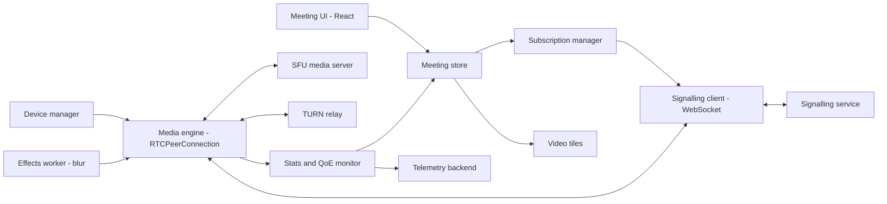

## 1. Requirements exploration

The defining constraint of video conferencing is **real-time media under bad networks**. Unlike video streaming,
you cannot buffer for seconds: mouth-to-ear latency must stay under ~300 ms or conversation breaks down. So the
front-end design is about choosing a media topology, controlling how much media each client sends and receives, and
building a UI that stays responsive while decoding many video streams.

### Functional requirements

- Join via link; pre-join screen with camera preview, device pickers, mic level meter, name entry.
- In-meeting: grid view, speaker view, pinned/spotlighted participants; active speaker highlight.
- Mute/unmute, camera on/off, screen share (with system or tab audio where supported), background blur.
- Chat, raise hand, reactions, participant list.
- Host controls: mute others (request), remove, lock meeting, waiting room.
- Reconnect transparently after network changes (Wi-Fi to mobile).
- Webinars: thousands of viewers receiving the stage only.
- Captions (live transcription) as a stretch.

### Non-functional requirements

| Concern | Target |
| --- | --- |
| Join time | link click to seeing others < 3 s p50 |
| Latency | glass-to-glass < 300 ms p95 within a region (audio first) |
| Audio | no dropouts at up to 5% packet loss (Opus FEC/PLC); audio prioritised over video |
| Video | 720p for the active speaker on good links, graceful step-down to thumbnails or audio-only |
| Scale | 100 publishing participants; render up to 49 tiles; 10k receive-only viewers |
| CPU | < 50% of one mid-range laptop core budget per 9 visible tiles; device stays cool on 1-hour calls |
| Reconnection | ICE restart within 2–5 s after network change without rejoining |
| Accessibility | full keyboard control, screen reader announcements, captions, WCAG 2.2 AA |

### Out of scope

- Server-side media infrastructure internals (SFU implementation, cascading between regions), recording pipeline,
  PSTN dial-in. We define the client contract with them.
- Native apps.

### Clarifying questions

1. Is end-to-end encryption required? (With an SFU, E2EE needs insertable streams / encoded transforms.)
2. Typical meeting size distribution? (Most meetings are small; optimise for them without breaking 100.)
3. Browser matrix? Safari and Firefox support differs for some APIs (e.g. tab audio capture, background effects).
4. Must webinar viewers have sub-second latency (interactive Q&A) or is a few seconds acceptable (HLS-style)?

Assume no E2EE by default (offered as a mode), evergreen browsers, sub-second latency for everyone.

## 2. Architecture / high-level design

### Media topology: mesh vs SFU vs MCU

| Topology | How it works | Client upload | Client download | Fits |
| --- | --- | --- | --- | --- |
| **Mesh (P2P)** | every client sends to every other client | N−1 streams | N−1 streams | 1:1 and ≤ 4 people; lowest server cost; uploads explode beyond that |
| **SFU** (Selective Forwarding Unit) | each client uploads once; server forwards selected streams/layers to each receiver without decoding | 1 stream (with simulcast layers) | only what is shown | the industry standard for groups |
| **MCU** (Multipoint Control Unit) | server decodes, composites into one video, re-encodes | 1 | 1 | legacy/low-power endpoints; very expensive server CPU, adds latency, fixed layout |

**Decision:** an **SFU for all group meetings**, with an optional P2P path for 1:1 calls (lower latency, less server
cost; switch to the SFU when a third person joins). Large webinars use SFU **cascading** (SFUs forwarding to edge
SFUs) for sub-second delivery, or an HLS/LL-HLS broadcast for very large passive audiences where 2–5 s latency is
acceptable.

### Signalling and connectivity

WebRTC does not define signalling. We use a WebSocket to a signalling service for: join/leave, SDP offer/answer,
ICE candidates (trickle), participant metadata, and app events (chat, hand raise). Media flows over UDP via
`RTCPeerConnection` to the SFU. Connectivity uses ICE with STUN for reflexive addresses and **TURN** relays (UDP,
TCP and TLS over 443) for restrictive firewalls; corporate networks often force TURN/TLS, so TURN servers in every
region are mandatory, not optional.

### Client components

| Component | Responsibility |
| --- | --- |
| **Meeting shell (React)** | routes, pre-join, layout, controls, panels, dialogs |
| **Meeting store** | participants, tracks, layout state, chat, roles; the UI's single source of truth |
| **Signalling client** | WebSocket, request/response correlation, reconnect, event dispatch |
| **Media engine** | `RTCPeerConnection`(s), transceivers, simulcast encodings, renegotiation, ICE restarts |
| **Device manager** | enumerate devices, permissions, `devicechange`, mute semantics, audio processing settings |
| **Subscription manager** | decides which remote tracks and which quality layer to receive based on layout and visibility |
| **Video tile renderer** | `<video>` elements per visible tile, attaching/detaching `MediaStream`s |
| **Effects pipeline** | background blur/replace using a segmentation model in a worker, via insertable streams |
| **Stats/QoE monitor** | polls `getStats()`, computes bitrate/loss/jitter/RTT, drives UI quality indicators and telemetry |



### Join sequence

1. Load meeting metadata (`GET /meetings/:id`), get a join token.
2. Pre-join: `getUserMedia` for preview; show device pickers and a mic level meter (Web Audio `AnalyserNode`).
3. Open the signalling WebSocket; receive participant list and SFU endpoint plus ICE servers (with short-lived TURN
   credentials).
4. Create a peer connection to the SFU; add audio and video transceivers (`sendonly`) with simulcast encodings;
   exchange SDP; trickle ICE.
5. Subscribe to remote tracks for the visible layout. Audio of the top few speakers is always subscribed.

## 3. Data model

```ts
type ParticipantId = string;

interface Participant {
  id: ParticipantId;
  displayName: string;
  avatarUrl?: string;
  role: 'host' | 'cohost' | 'participant' | 'viewer';
  joinedAt: number;
  handRaisedAt?: number;
  audio: { trackId?: string; muted: boolean };
  video: { trackId?: string; muted: boolean; layers: VideoLayer[] };
  screen?: { trackId: string; withAudio: boolean };
  connectionQuality: 'good' | 'fair' | 'poor' | 'lost';
}

interface VideoLayer { rid: 'q' | 'h' | 'f'; width: number; height: number; maxBitrate: number }

interface MeetingState {
  meetingId: string;
  self: ParticipantId;
  participants: Record<ParticipantId, Participant>;
  order: ParticipantId[];               // stable order for the grid
  activeSpeakers: ParticipantId[];      // most recent first, from SFU audio levels
  pinned: ParticipantId | null;
  layout: 'grid' | 'speaker' | 'sidebar';
  page: number;                         // grid pagination
  chat: ChatMessage[];
  locked: boolean;
}

interface Subscription {
  participantId: ParticipantId;
  kind: 'video' | 'screen';
  // what the UI needs; the SFU picks the layer
  maxWidth: number;
  maxHeight: number;
  priority: 'high' | 'normal' | 'low';
}
```

`MediaStream` and `RTCPeerConnection` objects are **not** stored in React state; they live in the media engine,
keyed by track ID. The store holds serialisable metadata, and tiles look up the stream by ID.

## 4. Interface definition (API)

### REST

```http
GET  /api/meetings/:id            -> { id, title, requiresWaitingRoom, e2ee, hostName }
POST /api/meetings/:id/join       { displayName } -> { token, signallingUrl, iceServers: [...], expiresAt }
```

### Signalling messages

```ts
type ClientMsg =
  | { t: 'join'; token: string; capabilities: { codecs: string[]; simulcast: boolean } }
  | { t: 'offer' | 'answer'; sdp: string }
  | { t: 'ice'; candidate: RTCIceCandidateInit }
  | { t: 'subscribe'; subs: Subscription[] }           // replaces the full set, idempotent
  | { t: 'mute'; kind: 'audio' | 'video'; muted: boolean }
  | { t: 'chat'; clientMsgId: string; text: string }
  | { t: 'raise-hand'; raised: boolean }
  | { t: 'host-action'; action: 'mute' | 'remove' | 'lock'; target?: ParticipantId };

type ServerMsg =
  | { t: 'joined'; self: Participant; participants: Participant[] }
  | { t: 'participant-joined' | 'participant-updated'; participant: Participant }
  | { t: 'participant-left'; id: ParticipantId }
  | { t: 'offer' | 'answer'; sdp: string }
  | { t: 'ice'; candidate: RTCIceCandidateInit }
  | { t: 'active-speakers'; ids: ParticipantId[] }
  | { t: 'bandwidth-estimate'; downlinkKbps: number }
  | { t: 'chat'; message: ChatMessage }
  | { t: 'request-unmute'; by: ParticipantId }         // hosts cannot force-unmute
  | { t: 'error'; code: 'MEETING_LOCKED' | 'REMOVED' | 'TOKEN_EXPIRED'; message: string };
```

### Video tile component

```ts
interface VideoTileProps {
  participantId: ParticipantId;
  trackId?: string;           // undefined renders avatar
  mirrored?: boolean;         // true for self-view only
  fit: 'cover' | 'contain';   // contain for screen shares
  isSpeaking: boolean;
  onVisibleSizeChange?: (size: { width: number; height: number } | null) => void; // null when off-screen
}
```

## 5. Optimizations and deep dives

### Simulcast, SVC and the subscription manager

- **Simulcast**: the sender encodes the camera at 2–3 resolutions (e.g. 180p, 360p, 720p) via
  `sendEncodings: [{ rid: 'q', scaleResolutionDownBy: 4 }, { rid: 'h', scaleResolutionDownBy: 2 }, { rid: 'f' }]`.
  The SFU forwards to each receiver the layer that fits its tile and bandwidth.
- **SVC** (scalable video coding, VP9/AV1 with `scalabilityMode` such as `L3T3`) achieves the same with one stream
  of layered frames; more efficient upload, supported in Chromium and increasingly elsewhere. Use it where supported
  with simulcast fallback.
- The client tells the SFU what it needs: each tile reports its rendered size (`ResizeObserver`) and visibility
  (`IntersectionObserver`), and the subscription manager sends a debounced `subscribe` message. Off-screen tiles
  are unsubscribed, a 160 px thumbnail never receives 720p. This is the biggest bandwidth and CPU lever the front end
  controls.
- Sender side: if nobody is watching my high layer, the SFU signals it, and the client can disable that encoding
  (`setParameters` with `active: false`) to save upload and CPU.

### Adaptive bitrate under bad networks

- WebRTC's congestion control (transport-wide feedback, GCC) estimates available bandwidth and adapts encoder bitrate
  automatically. The application layers on top:
  - **Priority**: audio first (`priority: 'high'` / `networkPriority` on audio encodings), then the active speaker,
    then screen share, then thumbnails.
  - **Degradation ladder**: reduce thumbnail layers → pause thumbnails (show avatars) → lower speaker resolution →
    audio-only, with UI messaging ("Your connection is unstable; video paused").
  - `degradationPreference`: `maintain-resolution` for screen share (text must be legible, framerate can drop),
    `maintain-framerate` for camera.
  - Opus with in-band FEC and DTX for audio; the jitter buffer handles reordering.
- Monitor `getStats()` every 1–2 s: `packetsLost`, `jitter`, `roundTripTime`, `availableOutgoingBitrate`,
  `framesDropped`, `qualityLimitationReason` (cpu vs bandwidth). If the limitation is CPU, reduce encoding layers or
  disable background effects rather than bitrate.

### Layouts and rendering performance

- Grid layout computes the best rows × columns for N tiles and the container aspect ratio, maximising tile size at
  16:9; paginate beyond a cap (e.g. 25 or 49 tiles) rather than shrinking tiles to postage stamps.
- Each visible tile has one `<video>` element with `srcObject`; avoid re-mounting tiles when order changes (stable
  keys, CSS grid order or transforms) because re-attaching streams causes black frames.
- Active speaker changes are frequent: debounce the speaker view switch (~1–2 s) to avoid flicker; highlight
  speaking tiles with a CSS outline driven by audio levels, updated outside React (direct DOM class toggles) to avoid
  re-rendering the grid 10 times per second.
- Hardware decoding: most browsers decode VP8/H.264 in hardware; many 720p decodes still cost CPU, which is another
  reason to subscribe to small layers for small tiles.
- Background tab: browsers throttle timers; keep audio running; pause video rendering (unsubscribe from video) when
  `document.visibilityState` is hidden, which saves significant CPU.
- Picture-in-picture: `requestPictureInPicture()` on a video element, or the Document Picture-in-Picture API
  (Chromium) to pop out a mini meeting window with controls.

### Devices and permissions

- Request permissions in the pre-join screen with context, not on page load. Handle `NotAllowedError`
  (show how to re-enable in browser settings), `NotFoundError` (no camera) and `NotReadableError` (device in use by
  another app).
- `devicechange` events: when headphones are plugged in, switch the output (`setSinkId`, where supported) and offer
  the new mic. Persist preferred device IDs in `localStorage`.
- Mute semantics: muting the mic should stop sending audio immediately (`track.enabled = false` keeps the device
  light on; stopping the track releases it but re-acquiring takes time). Use `enabled = false` for audio (fast
  unmute) and stop the camera track when video is off (privacy: light off).
- "You are muted" detection: watch local audio levels while muted and show a hint.
- Echo cancellation, noise suppression and auto gain via `getUserMedia` constraints; optional ML noise suppression
  in an `AudioWorklet`.

### Screen sharing

- `getDisplayMedia()` must be triggered by a user gesture; tab/system audio availability varies by browser and OS.
- Send as a separate track with `contentHint = 'detail'` (or `'text'`) so the encoder favours sharpness.
- Detect the user stopping the share from browser UI (`track.onended`) and update state.
- Warn when sharing the meeting tab itself (hall-of-mirrors effect).

### Background effects

Segmentation (a small ML model via WebGL/WebGPU or WebAssembly SIMD) runs per frame in a worker using
`MediaStreamTrackProcessor`/`VideoTrackGenerator` (insertable streams for raw media, Chromium; Safari has its own
variants) or a canvas pipeline fallback. Budget ~5–8 ms per frame; auto-disable when `qualityLimitationReason` is
`cpu`.

### Reliability

- ICE restart on `iceconnectionstatechange` to `disconnected`/`failed` or on `online` events; keep the meeting UI and
  show "Reconnecting…" instead of dropping the user.
- Signalling WebSocket reconnect with exponential backoff and session resume token; server replays missed state as a
  fresh snapshot.
- If UDP is blocked, ICE falls back to TURN over TCP/TLS: higher latency but works.

### Security and privacy

- Meeting tokens are short-lived; TURN credentials are ephemeral.
- WebRTC media is always encrypted (DTLS-SRTP) hop by hop; with an SFU the server can see media. For E2EE, encrypt
  frames with the Encoded Transform API (`RTCRtpScriptTransform`) using keys exchanged out of band; the SFU still
  routes by headers. Cost: no server-side recording or transcription.
- Indicators: always show when the camera/mic is live; never start media without explicit user action.

### Accessibility

- Every control is a labelled button with state (`aria-pressed` for mute toggles) and a keyboard shortcut
  (e.g. `Ctrl/Cmd+D` mute) listed in a help dialog; shortcuts never conflict with screen reader keys.
- Announce join/leave, hand raises and chat messages via polite live regions, with a setting to reduce verbosity in
  large meetings.
- Captions: a caption region with adjustable size; speaker names; keep it out of the video tiles so it is readable.
- Tiles have accessible names ("Ana, speaking, camera off"); provide a participant list as the accessible
  alternative to the video grid.

### Observability

- Per-call QoE: join time, time to first remote frame, average bitrate, freeze count, audio concealment ratio, CPU
  limitation time, reconnects. Sampled `getStats()` summaries sent at end of call (and periodically for long calls).
- Segment by browser, OS, network type and region; alert on regressions after a client release.

## What a lead-level answer adds

- Picks topology by meeting size (P2P for 1:1, SFU for groups, cascaded SFU or broadcast for webinars) and explains
  the bandwidth maths instead of naming acronyms.
- Recognises that the client controls quality through **subscriptions**: what you render determines what you
  receive, tying the layout engine to the network layer.
- Prioritises audio explicitly and designs a degradation ladder with user-facing messaging.
- Keeps media objects and high-frequency signals (audio levels, stats) out of React state.
- Has an operational story: TURN everywhere, QoE dashboards, browser-specific issues tracked, and staged rollouts of
  client changes because a regression can ruin thousands of meetings.

## Common follow-up questions

**Why not mesh for 10 people?** Each client would upload 9 copies of its video (e.g. 9 × 1 Mbps) and encode them
separately; home uplinks and laptop CPUs cannot sustain it.

**How do you detect the active speaker?** The SFU reads audio level RTP header extensions without decoding and
publishes a ranked list; the client can also use `getSynchronizationSources()` audio levels for local smoothing.

**How do you support 10,000 webinar viewers?** Viewers are receive-only; use cascaded SFUs near viewers, or transcode
the stage to LL-HLS for 2–5 s latency at CDN cost. Q&A goes through the signalling channel, not media.

**How would you implement recording?** A server-side bot joins as a hidden participant and composites streams, or
the SFU writes tracks for later composition. Recording requires consent notices for all participants.

**What changes with E2EE?** Frame encryption via encoded transforms, key rotation when participants leave, no server
features that need plaintext media, and verification UI (safety codes).

**How do you test this?** Fake media devices in Chromium (`--use-fake-device-for-media-stream`), network shaping
(packet loss, latency) in CI with multiple headless clients, and synthetic monitoring calls in every region.
