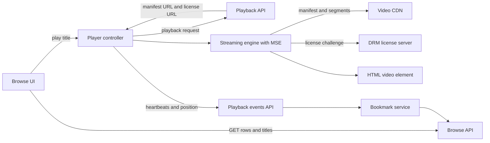

## 1. Requirements exploration

A streaming client has two very different halves: a **browse UI** (a giant, image-heavy, keyboard-navigable grid
of rows) and a **player** (a real-time media pipeline where the metric that matters is rebuffering, not React
render time). A good answer designs both and explains how they hand off.

### Functional requirements

- Profile selection; browse page of rows (each row horizontally scrollable, 10–40 titles), a hero billboard with an
  autoplaying muted trailer.
- Hover/focus on a title card expands it with a short preview video and quick actions (play, add to list, rate).
- Title details: synopsis, cast, seasons and episodes, maturity rating.
- Player: play/pause, seek with thumbnail previews, skip intro, next-episode countdown, volume, full screen,
  subtitles and audio track selection, quality auto-adaptation.
- Continue watching: resume position synced across devices; "My List".
- Search (with autocomplete — see that question).

### Non-functional requirements

| Concern | Target |
| --- | --- |
| Time to first frame | < 2 s p75 after pressing Play on broadband; < 4 s on mobile |
| Rebuffering | < 0.5% of watch time spent stalled; zero stalls for most sessions |
| Quality | highest sustainable bitrate; minimal quality switches |
| Browse page | LCP < 2.5 s; 60 fps row scrolling; on TVs, focus moves < 100 ms after a key press |
| Memory | low-end TVs with ~1 GB RAM and slow CPUs: bounded DOM and image memory |
| Protection | DRM via EME (Widevine, PlayReady, FairPlay) and per-region licensing |
| Resume accuracy | within ~10 s of the last position across devices |

### Out of scope

Encoding pipeline, CDN placement (e.g. Open Connect appliances), recommendation algorithms, payments, native apps.

### Clarifying questions

1. Browsers and devices: desktop browsers + smart TVs (which engines? old Chromium/WebKit builds on TVs constrain
   JS features).
2. DRM requirements per content tier (e.g. 4K only with hardware-level DRM).
3. Live content (sports) or only on-demand? Live changes latency and manifest handling.
4. Offline downloads on web? (Typically not; assume no.)
5. Ads tier? (Adds server- or client-side ad insertion.)

## 2. Architecture / high-level design

### Browse app

- **SSR or prerendered shell** with the first rows' data inlined for fast LCP on desktop; on TVs the app is often a
  packaged SPA loaded from the device or a CDN, so focus on startup JS cost and memory instead.
- **Row virtualization in two dimensions**: only rows near the viewport are mounted, and within each row only cards
  near the visible window.
- **Focus management engine** for TV/keyboard: spatial navigation (arrow keys move focus to the nearest card in that
  direction) with remembered focus per row.

### Player

The `<video>` element alone can play an MP4, but adaptive streaming needs a **player engine** built on Media Source
Extensions (MSE): it downloads a manifest (DASH `.mpd` or HLS `.m3u8`), picks a bitrate rendition, fetches media
segments, appends them to `SourceBuffer`s, and handles DRM via Encrypted Media Extensions (EME). Use a proven engine
(Shaka Player, hls.js, dash.js, or an in-house one at Netflix scale) rather than writing one in an interview — but
explain how it works. Safari on iOS historically lacked MSE on iPhone (Managed Media Source arrived in iOS 17.1), so
native HLS playback remains a needed path.

```
<App>
  <ProfileGate />
  <BrowsePage>
    <Billboard />                 // hero with muted trailer
    <RowList>                     // vertical virtualization
      <Row title="Continue watching">
        <RowTrack>                // horizontal virtualization, arrows/paging
          <TitleCard />           // boxart image; expands on hover/focus
    <TitlePreviewPopover />       // shared preview player instance
  <TitleDetailsModal />
  <PlayerPage>
    <VideoSurface />              // <video> element managed by the engine
    <PlayerControls />            // play, seek bar, volume, tracks, fullscreen
    <SubtitleRenderer />          // custom-rendered cues for styling consistency
    <SkipIntroButton /> <NextEpisodeCard />
    <PlayerErrorOverlay />
```



## 3. Data model

```ts
type ID = string;

interface Title {
  id: ID;
  type: 'movie' | 'show';
  name: string;
  synopsis: string;
  maturityRating: string;
  artwork: { boxart: ImageSet; billboard?: ImageSet; logo?: ImageSet }; // personalised artwork variants chosen by server
  previewVideoId?: ID;
  seasons?: { id: ID; number: number; episodeIds: ID[] }[];
}

interface ImageSet { url: string; width: number; height: number; variants: { w: number; url: string }[] }

interface Row {
  id: ID;
  title: string;
  kind: 'continue_watching' | 'top10' | 'genre' | 'my_list' | 'standard';
  titleIds: ID[];               // first page only; rest paginated
  nextCursor?: string;
}

interface Bookmark { titleId: ID; episodeId?: ID; positionSec: number; durationSec: number; updatedAt: string }

// Player session state (client only, not in a global server cache)
interface PlaybackSession {
  sessionId: ID;
  titleId: ID;
  state: 'loading' | 'playing' | 'paused' | 'buffering' | 'seeking' | 'ended' | 'error';
  positionSec: number;
  bufferedAheadSec: number;
  currentBitrateKbps: number;
  estimatedBandwidthKbps: number;
  audioTrack: string;           // language code
  textTrack: string | null;
  volume: number;
  muted: boolean;
  error?: { code: string; fatal: boolean };
}

interface BrowseStore {
  titles: Record<ID, Title>;    // normalized: a title appears in many rows
  rows: Record<ID, Row>;
  rowOrder: ID[];
  bookmarks: Record<ID, Bookmark>;
  focus: { rowIndex: number; perRowIndex: Record<ID, number> };   // remembered focus for TV navigation
}
```

**Where state lives:** catalog data in a normalized query cache; bookmarks fetched with the page and updated by the
player; high-frequency player state (position, buffer) lives **in the engine and refs**, surfaced to React at a low
rate (e.g. 4 Hz for the seek bar via `timeupdate`, not 60 Hz), so the player UI doesn't re-render constantly.
User preferences (subtitle language, size, audio language) persist per profile on the server, cached locally.

## 4. Interface definition (API)

### Browse

```http
GET /api/browse?profileId=p_2&rows=0-8&itemsPerRow=20
```

```json
{
  "rows": [
    { "id": "r_cw", "kind": "continue_watching", "title": "Continue Watching for Sam", "titleIds": ["t_12", "t_88"], "nextCursor": null },
    { "id": "r_trend", "kind": "standard", "title": "Trending Now", "titleIds": ["t_5", "t_9"], "nextCursor": "c2"}
  ],
  "titles": {
    "t_12": { "id": "t_12", "type": "show", "name": "The Long Orbit",
              "artwork": { "boxart": { "url": "https://art.example.com/t_12/b_342.webp", "width": 342, "height": 192, "variants": [] } } }
  },
  "bookmarks": { "t_12": { "titleId": "t_12", "episodeId": "e_4", "positionSec": 1312, "durationSec": 2950, "updatedAt": "2025-03-01T21:12:00Z" } },
  "nextRowsCursor": "rows:9"
}
```

Two-level pagination: rows load lazily as the user scrolls down (`rows` cursor), and each row loads more titles when
the user pages right (`/api/rows/r_trend?cursor=c2`). Cursor pagination because rows are personalised and generated
per session. GraphQL fits this nested, per-device shape well (Netflix has written about Falcor and later GraphQL
federation); REST with side-loaded entities works too.

### Playback

```http
POST /api/playback
{ "titleId": "t_12", "episodeId": "e_4", "profileId": "p_2",
  "capabilities": { "codecs": ["av01", "hvc1", "avc1"], "drm": ["com.widevine.alpha"], "hdr": false, "maxHeight": 1080 } }
```

```json
{
  "sessionId": "ps_771",
  "manifestUrl": "https://cdn3.example.net/m/e_4/manifest.mpd?token=...",
  "fallbackManifestUrls": ["https://cdn7.example.net/m/e_4/manifest.mpd?token=..."],
  "license": { "keySystem": "com.widevine.alpha", "url": "https://license.example.com/widevine?session=ps_771" },
  "startPositionSec": 1312,
  "markers": { "introStart": 30, "introEnd": 92, "creditsStart": 2870 },
  "textTracks": [{ "lang": "en", "kind": "subtitles", "url": "https://cdn3.example.net/s/e_4/en.vtt" }],
  "nextEpisodeId": "e_5"
}
```

The client detects capabilities with `MediaSource.isTypeSupported`, `navigator.mediaCapabilities.decodingInfo`
(includes smoothness and power efficiency) and `navigator.requestMediaKeySystemAccess`, so the server returns only
renditions the device can play.

### Playback events

```http
POST /api/playback/ps_771/events
{ "events": [
  { "type": "heartbeat", "positionSec": 1342, "bitrateKbps": 5800, "bufferSec": 24, "ts": 1740863521000 },
  { "type": "rebuffer", "positionSec": 1350, "durationMs": 820 },
  { "type": "pause", "positionSec": 1361 }
] }
```

Heartbeats every ~30 s plus on pause/seek/exit update the bookmark. On tab close, send the final position with
`navigator.sendBeacon` on `visibilitychange` → hidden.

### Component props

```ts
interface PlayerProps {
  titleId: ID;
  episodeId?: ID;
  startPositionSec?: number;
  autoPlay?: boolean;
  onExit: () => void;
  onEnded?: (nextEpisodeId?: ID) => void;
}

interface RowProps {
  rowId: ID;
  isFocusedRow: boolean;               // TV focus engine
  onCardFocus: (titleId: ID, index: number) => void;
  renderCard: (titleId: ID, opts: { focused: boolean; priority: boolean }) => React.ReactNode;
}
```

## 5. Optimizations and deep dives

### Adaptive bitrate (ABR)

- Content is encoded in a **bitrate ladder** (e.g. 235 kbps 320p … 16 Mbps 4K), per-title optimised, split into
  2–6 s segments, each rendition aligned so the player can switch at segment boundaries.
- ABR algorithms: **throughput-based** (estimate bandwidth from recent segment downloads, EWMA), **buffer-based**
  (pick bitrate from buffer occupancy — e.g. BOLA), or hybrids. Throughput-based reacts fast but oscillates;
  buffer-based is stable but slow to ramp up at start. Most production players combine them.
- Startup: begin with a conservative rendition (or one based on the last session's bandwidth stored locally) to get
  the first frame fast, then ramp up. Keep a target buffer (e.g. 30–60 s on desktop; smaller on memory-constrained
  TVs, since `SourceBuffer` memory is limited and `QuotaExceededError` must be handled by evicting played ranges).
- Cap resolution to the player's display size × DPR — no point streaming 4K into a 640 px window — and to
  device capabilities (`mediaCapabilities`).

### Fast start

- Prefetch on intent: when a card is focused/hovered for > 500 ms, call the playback API and fetch the manifest and
  first segments of the likely start position; pre-acquire the DRM license (license requests often dominate startup).
- Preconnect to the CDN and license servers when the user enters the details page.
- Start position from the bookmark is known up front, so the first segments fetched are the right ones.
- Lazy-load the player engine chunk (it's large) on browse page idle, before the user presses Play.

### Resilience

- Retry failed segment downloads with backoff; switch to a fallback CDN URL after repeated failures (CDN steering).
- If the buffer drains, drop to a lower rendition immediately. Show a spinner only after ~300 ms of stall to avoid
  flicker.
- DRM license renewal for long sessions; handle `keystatuseschange` (e.g. output restricted for HDCP) by
  falling back to lower resolutions instead of failing.
- Error taxonomy with user-facing codes ("Error NW-2") for support, and auto-recovery for transient errors.

### Browse page performance

- **Images dominate**: boxart via `srcset` sized for the card width; WebP/AVIF; fixed aspect-ratio boxes; the first
  visible row eager, the rest lazy. Personalised artwork is chosen server-side, so the client just renders URLs.
- Virtualize rows vertically and cards horizontally; on TVs this is essential to stay within memory.
- **One shared preview player**: never create a `<video>` per card. A single preview player instance moves to the
  hovered/focused card, plays a short low-bitrate muted preview after a dwell delay, and is torn down when focus
  leaves. Respect a user setting to disable autoplay previews and `prefers-reduced-motion`.
- Animations (card expand) use `transform`/`opacity` only; avoid layout-triggering properties on low-end TV
  CPUs. The View Transitions API can animate card → details where supported.
- Billboard trailer starts only after the page is interactive and pauses when scrolled out of view or the tab is
  hidden.

### TV and keyboard navigation

- Spatial navigation engine: arrow keys move focus between cards and rows; each row remembers its last focused index
  so moving down then up returns to the same card. Use `tabindex="-1"` + roving focus rather than tabbing through
  hundreds of cards.
- Keep the focused card visible by scrolling the row with `transform` (cheaper than `scrollLeft` on some TV
  engines).
- Handle remote keys (Back, Play/Pause) via key codes that vary per platform — abstract them in an input layer.
- Focus is the primary state on TV: design it as data (row/col indices), not as DOM side effects.

### Player accessibility

- Controls are real buttons with labels and keyboard shortcuts (Space/K play-pause, ←/→ seek 10 s, F full screen,
  M mute, C captions), documented, and not hijacking keys when a menu is open.
- The seek bar is a `role="slider"` with `aria-valuetext="22 minutes 5 seconds of 49 minutes"`.
- Captions: WebVTT/TTML parsed and rendered with a custom renderer (consistent styling across browsers), honouring
  user caption preferences (size, color, background, edge) — required by regulations like the US CVAA for
  video programming. Audio description tracks offered as alternate audio.
- Controls auto-hide during playback but reappear on any key press or pointer move; never hide while focused.
- Media Session API sets metadata and handlers so hardware media keys, lock screens and OS controls work.

### Internationalization

- Audio and subtitle defaults chosen from profile preferences then locale; remember per-profile choices.
- Subtitles for RTL languages and CJK need correct font fallback and line breaking; `lang` attribute on cue
  containers.
- UI strings via ICU messages; dates and durations with `Intl` (`Intl.DurationFormat` where supported, with fallback).
- Content availability varies by region: the API decides; the client must handle "not available in your region".

### Security and content protection

- DRM via EME with the appropriate key system per browser (Widevine on Chrome/Firefox/Edge, PlayReady on Edge/TVs,
  FairPlay on Safari). Higher resolutions only with hardware-backed security levels.
- Short-lived signed manifest/segment URLs (tokenised CDN URLs) to prevent hotlinking.
- Concurrent stream limits enforced server-side through playback session heartbeats.
- Standard web security: CSP, `HttpOnly` cookies, CSRF protection; subtitle files are parsed as text, never injected
  as HTML (cue text may contain markup tags — whitelist `<i>`, `<b>` only).

### Observability (quality of experience)

- QoE metrics per session: time to first frame, rebuffer ratio, average bitrate, quality switches, exits before
  video start, fatal error rate, license latency. Segment by CDN, ISP, device, region.
- Use these for A/B testing ABR changes; small regressions in rebuffering have big engagement impact.
- Browse UI: Web Vitals, TV key-to-focus latency, memory usage, image decode failures.

### Testing

- Player engine tested with recorded network traces (throttled bandwidth profiles, packet loss) in automated labs —
  emulate 3G, fluctuating Wi-Fi, CDN failure.
- Device lab for TVs and set-top boxes (real hardware; emulators miss decoder and memory quirks).
- Component tests for controls and focus navigation; E2E for "browse → play → resume on another device".
- Visual regression for subtitles rendering across languages.

## What a lead-level answer adds

- Separates **QoE engineering** (player) from **UI engineering** (browse) and gives each its own success metrics,
  ownership and release process (player changes behind gradual rollouts with automatic rollback on QoE regression).
- Knows the **platform matrix** (DRM key systems, MSE vs Managed Media Source vs native HLS, TV browser engines) and
  plans a capability-detection layer instead of user-agent sniffing.
- Designs for **constrained devices**: memory budgets, one preview player, transform-based scrolling, small buffers.
- Talks about **cost**: CDN egress dominates spend; capping resolution to window size and smarter ABR save real money
  without hurting QoE.
- Uses experimentation at scale (artwork, row order, ABR parameters) with guardrail metrics.

## Common follow-up questions

**Why not just use a `<video src="movie.mp4">`?** No adaptation to bandwidth, poor seeking for long files, no DRM
key rotation, and wasteful bytes. MSE + segmented ABR solves all of these.

**HLS or DASH?** DASH is codec-agnostic and common with MSE players; HLS is required for native playback on older
iOS. With CMAF segments, one set of media files can serve both manifests.

**How does "Continue watching" stay accurate?** Heartbeats every ~30 s, plus events on pause/seek/exit and a beacon on
page hide; the server stores the latest by `updatedAt`, so the most recent device wins.

**How would you support live sports?** Shorter segments or low-latency modes (LL-HLS, LL-DASH with chunked CMAF),
a live edge indicator, smaller buffers, and a DVR window; latency vs rebuffer trade-off becomes explicit.

**How do previews avoid wasting bandwidth?** Dwell delay before playing, low bitrate renditions, cancel on focus
change, disabled on Save-Data or metered connections.
