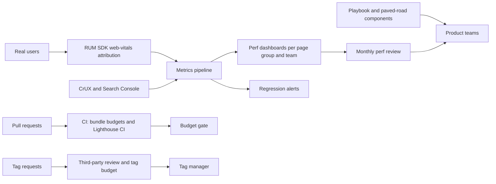

## Framing the problem

The telling detail in the brief is that previous performance sprints **worked, then regressed**. That means the
organisation knows how to make pages fast but has no system that **keeps** them fast. Performance is an emergent
property of hundreds of daily changes by 20 teams plus marketing's tag manager; a one-off project cannot hold it.

So the program is designed like any other platform:

- **Measurement everyone trusts**, attributable to pages, teams and releases.
- **Targets and budgets** that turn "be fast" into numbers each team owns.
- **Guardrails** in CI and in the tag pipeline that stop regressions before they reach users.
- **A playbook and paved road** so the fix is usually "use the platform component", not heroics.
- **Governance and incentives**: ownership, reviews, and business-impact reporting that keep leadership invested.

The technical fixes matter, but they are the easy part. The hard part is the operating model.

## 1. Requirements exploration

### Stakeholders

- **VP Engineering and product leadership**: a credible plan, progress reporting, business impact.
- **20 product teams**: clear targets, tools that tell them what to fix, low friction.
- **Marketing and analytics**: their tags keep working; a fair process for adding new ones.
- **SEO**: page groups passing CWV in Search Console (page experience is a ranking signal, though a modest one).
- **Platform / infra**: CDN, image service, build tooling.

### Goals and constraints

- **Target**: within three quarters, the top page groups (home, search/listing, product, cart/checkout) pass CWV at
  p75 on mobile in field data: **LCP ≤ 2.5 s, INP ≤ 200 ms, CLS ≤ 0.1**.
- **Sustain**: no page group falls out of "good" for more than 2 consecutive weeks after reaching it.
- Field data is the arbiter. CrUX (what Search Console and PageSpeed Insights report) is a 28-day rolling window of
  Chrome users, so changes take up to four weeks to show fully; our own RUM gives daily feedback.

### Clarifying questions

- What stack are the properties on? (Assume a mix: Next.js storefront, an older SPA for account, CMS-driven blog.)
- Who controls the tag manager, and is there an existing approval process?
- Do we have RUM today? Is there an experimentation platform to measure business impact?
- What is the device mix? (Retail mobile traffic skews to mid- and low-end Android, which is where INP fails.)

## 2. Architecture of the program



Five pieces:

1. **Field measurement (RUM)** with attribution, segmented by page group, device class, country, release and A/B
   variant.
2. **Lab measurement in CI**: bundle-size budgets, Lighthouse CI on representative pages, and synthetic monitoring
   of production on a schedule.
3. **Budgets and gates**: per page group and per team, enforced in CI and in the tag-approval workflow.
4. **Paved road**: platform components and defaults that make the fast path the easy path (image component, font
   loading, script loader, route-level code splitting, server rendering templates).
5. **Operating cadence**: dashboards, alerts routed to owners, monthly review, quarterly targets.

## 3. Data model and contracts

### Page groups and ownership

Everything is reported by **page group** (a route template), never by raw URL:

```yaml
pageGroups:
  - id: product-detail
    match: "/p/:slug"
    owner: team-product-page
    tier: 1                  # tier 1 = revenue critical
    targets: { lcp_p75_ms: 2500, inp_p75_ms: 200, cls_p75: 0.1 }
    budgets:
      js_initial_kb_gz: 170
      third_party_js_kb_gz: 80
      lcp_lab_ms: 2200       # Lighthouse CI, mobile profile
      image_lcp_kb: 120
  - id: checkout
    match: "/checkout/*"
    owner: team-checkout
    tier: 1
    targets: { lcp_p75_ms: 2500, inp_p75_ms: 150, cls_p75: 0.05 }
```

This file lives in the repository, is reviewed like code, and drives dashboards, CI budgets and alert routing.

### RUM event

```json
{
  "metric": "INP",
  "value": 412,
  "pageGroup": "product-detail",
  "release": "storefront@2025.06.02-a1b2c3",
  "device": { "class": "mobile-low", "memoryGB": 4, "cores": 8 },
  "connection": "4g",
  "country": "IN",
  "navigationType": "navigate",
  "attribution": {
    "interactionTarget": "button.size-selector",
    "interactionType": "pointer",
    "inputDelay": 96,
    "processingDuration": 251,
    "presentationDelay": 65,
    "longestScript": { "url": "https://cdn.acme.com/_next/static/chunks/pdp.js", "durationMs": 210, "invoker": "click" }
  },
  "experiments": { "pdp-gallery-v2": "treatment" }
}
```

The `web-vitals` attribution build plus the **Long Animation Frames (LoAF)** API identify which script and which
handler caused a slow interaction, which is what makes INP actionable.

## 4. Interfaces

### For product teams

- **Dashboard** per page group: p75 trend for LCP/INP/CLS (RUM daily, CrUX 28-day), distribution by device class,
  top INP interactions with attribution, LCP element and sub-part breakdown (TTFB, resource load delay, resource load
  duration, element render delay), CLS sources, and release markers.
- **PR comment** from CI:

```
Performance budget report: product-detail
  Initial JS (gz):   168 KB / 170 KB   (+6 KB)  ok
  Third-party JS:     74 KB /  80 KB            ok
  Lighthouse LCP:   2.41 s / 2.20 s             FAIL
  Largest new module: react-zoom-pan (+23 KB) imported in Gallery.tsx
```

- **Alerts**: "INP p75 on product-detail exceeded 200 ms for 3 consecutive days, started with release a1b2c3" to the
  owning team's channel.

### CI integration

```bash
perf-budget check --page-groups perf/page-groups.yaml --stats .next/analyze/stats.json
lhci autorun --config lighthouserc.json     # median of 3–5 runs per URL, mobile emulation
```

Gates: bundle budgets are **blocking** (deterministic); Lighthouse lab metrics are **blocking only for large
regressions** (variance in lab runs makes small thresholds flaky) and otherwise warn. Overrides need a code-owner from
the performance guild plus a ticket.

### Third-party tag process

A request form (owner, purpose, page groups, expected size, loading strategy, data shared, expiry date), reviewed by
the performance and privacy owners. Tags have a **budget per page group** and an **expiry**; expired tags are removed
automatically unless renewed.

## 5. Deep dives and trade-offs

### Measurement: lab vs field

| Source | Strengths | Limits | Use |
| --- | --- | --- | --- |
| CrUX / Search Console | What Google uses; free | 28-day lag, Chrome only, coarse segmentation, no attribution | Executive target and SEO |
| Own RUM | Daily, segmented, attribution, joins with releases and experiments | Needs SDK and pipeline; sampling | Primary operational metric |
| Lighthouse CI / WebPageTest | Deterministic-ish, per PR, detailed traces | Not real users; cannot measure INP (only TBT as a proxy) | Regression prevention |
| Synthetic monitoring (SpeedCurve, Calibre, DebugBear) | Scheduled production checks, competitor benchmarks | Lab conditions | Early warning, trend |

Commercial RUM (SpeedCurve, Datadog RUM, Sentry, Akamai mPulse, DebugBear) versus in-house: if an observability
platform exists, add vitals with attribution to it rather than buying a separate tool. The decisive features are
attribution, segmentation by page group and release, and the ability to join with experiment variants.

### Technical playbook (what usually fixes each metric)

**INP (the worst metric here)**
- Break up long tasks: yield to the main thread in event handlers (`scheduler.yield()` where supported, with a
  `setTimeout`-based fallback), do the visual update first and defer the rest.
- Reduce hydration cost: server components or islands for non-interactive content, selective/lazy hydration,
  smaller client bundles. React 18+ concurrent features (`startTransition`, `useDeferredValue`) keep inputs responsive
  during expensive re-renders.
- Avoid expensive re-renders: memoisation where profiling shows wasted renders, state colocated near where it is used,
  virtualization for long lists.
- Third-party scripts: tag-manager tags often dominate input delay. Delay non-critical tags until after load or
  interaction; move some to server-side tagging; consider a worker-based approach (Partytown) with care, since it
  breaks some tags.
- Avoid layout thrashing and huge DOMs (product pages with thousands of nodes for variants and reviews).

**LCP**
- Make the LCP resource discoverable early: real `` in server HTML (not a client-rendered carousel), with
  `fetchpriority="high"`; never lazy-load the LCP image.
- Image service: responsive `srcset`/`sizes`, AVIF/WebP, correct dimensions, CDN caching.
- TTFB: edge caching of HTML (stale-while-revalidate), streaming SSR, fewer redirects.
- Fonts: `font-display: swap` or `optional`, preload only the critical font, subset.
- Render-blocking CSS and synchronous scripts in `<head>` removed.
- Instant navigations: bfcache eligibility (no `unload` handlers, no `Cache-Control: no-store` on HTML unless needed)
  and the Speculation Rules API to prerender likely next pages (for example, from listing to product).

**CLS**
- Reserve space: `width`/`height` or `aspect-ratio` on images and embeds; fixed-height slots for ads and promotional
  banners; skeletons with final dimensions.
- No content insertion above existing content after load (cookie banners as overlays, not pushing content).
- Fonts with metric overrides (`size-adjust`, `ascent-override`) to reduce swap shifts.
- Animate with `transform`, not layout properties.

The playbook is turned into **platform components and lint rules** (an `<Image>` that requires dimensions and sets
priority for above-the-fold, a `<Script strategy>` loader, a font package, an ESLint rule against `unload` handlers),
so teams fix classes of problems once.

### Prioritisation

Not every page matters equally. Rank page groups by **traffic × revenue × gap to target**, start with product detail and
listing pages on mobile, and focus on the **largest contributor per metric** shown by attribution. Typical early wins:
LCP image priority and sizing, removing two or three heavy tags, hydration reduction on product pages.

### Third-party governance

Third parties are frequently the single largest INP and main-thread cost on retail sites, and they are owned by people
outside engineering. The program needs:

- A **tag inventory** with owner, purpose, cost (measured main-thread time and bytes per page group) and expiry.
- A **tag budget** per page group; a new tag must fit or something else leaves.
- **Loading policy**: consent-gated, deferred by default, never synchronous in `<head>`; A/B test tag impact when
  disputed (a tag-off holdout often settles arguments quickly).
- Quarterly tag review with marketing, showing cost and the usage data of each tag.

### Proving business impact

Leadership attention fades unless performance is tied to money. Methods:

- **Experiments**: deliberately slow a small holdout (or speed up treatment) and measure conversion. Even a simple
  "remove tag X" A/B test gives causal numbers.
- **Correlation analysis** from RUM joined with analytics: conversion rate by LCP/INP bucket, controlling for device
  and country (correlation, so present it as such).
- **SEO**: passing CWV URL groups in Search Console and organic traffic trends, with honest caveats that ranking
  impact is modest relative to content relevance.

### Sustaining: why previous sprints regressed and how this differs

- Regressions arrived through unbudgeted code and tags; now **budgets block** and **alerts route to owners**.
- Nobody owned page groups; now each has a named owning team and target.
- Fixes were local; now they are encoded in **paved-road components and lint rules**.
- Measurement lagged 28 days; now **daily RUM** with release markers makes cause and effect visible.

## Org and people considerations

- **Ownership model**: a small **performance platform team** (2–4 engineers) owns measurement, CI tooling, the
  playbook, paved-road components and the tag process. **Product teams own their page groups' metrics** and fix their
  regressions. A **performance guild** of champions (one per team) meets biweekly to share fixes.
- **Executive sponsorship**: the VP sets CWV targets as part of quarterly engineering goals; product managers own them
  alongside feature goals, so performance work is planned, not squeezed in.
- **Error budgets for performance**: when a page group falls out of "good", its owning team prioritises recovery over
  new features for that surface, similar to SRE error budgets. Agree this policy up front.
- **RFCs** for platform-wide changes (framework upgrades, rendering strategy shifts like moving to server components),
  with performance impact estimates.
- **Deprecation**: legacy patterns (client-only rendering of product pages, old carousel, synchronous tags) are listed
  with owners and removal dates on the dashboard.
- **Recognition**: celebrate wins publicly with business numbers; performance work is often invisible otherwise.

### Roadmap

- **Quarter 1**: RUM with attribution everywhere; page-group config; dashboards; tag inventory; bundle budgets in CI
  (warn mode); quick wins on product and listing pages (LCP image, two heavy tags deferred).
- **Quarter 2**: budgets blocking; Lighthouse CI; paved-road components; INP program (hydration reduction, long-task
  breaking, tag deferral); first business-impact experiment.
- **Quarter 3**: remaining tier-1 groups; speculation rules and bfcache; tag budgets enforced; error-budget policy live;
  hand over steady-state operation to teams with the platform team in a support role.

### Success metrics

- Percentage of tier-1 page groups passing all three CWV at p75 mobile (CrUX), and percentage of page views with "good"
  experiences (RUM).
- Weeks out of "good" after first reaching it (sustainability).
- Number of regressions caught in CI vs detected in production; time to detect and fix production regressions.
- Third-party main-thread time per page group; tags removed.
- Business: conversion uplift from experiments; bounce rate on mobile; organic traffic.

## What a lead-level answer adds

- Diagnoses the **organisational failure** (regressions after sprints) and designs an operating model, not just
  optimisations.
- Uses **field data as the source of truth**, with RUM attribution (web-vitals, LoAF) to make INP fixable, and knows
  CrUX's 28-day lag.
- Introduces **page-group ownership, budgets and error-budget policies** that make performance everyone's job with
  clear accountability.
- Treats **third-party tags as a governed resource** with budgets, expiry and measured cost.
- Ties the work to **business impact** with experiments, keeping leadership sponsorship through three quarters.

## Common follow-up questions

**Lighthouse scores are 95 but CrUX fails. Why?**
Lighthouse runs one simulated device on a clean load, without user interactions, consent banners, logged-in state or
real third-party behaviour. INP cannot be measured by Lighthouse at all. Trust the field data and use lab tools for
regression detection.

**A product manager wants a new personalization script that adds 150 ms of main-thread time. What do you do?**
Show the cost against the page group's budget, propose alternatives (server-side personalization, deferred loading),
and if it must ship, run it as an experiment measuring both its benefit and the INP/conversion cost. Make the trade-off
explicit and let the owner decide with data.

**Should the budget gate block merges?**
Deterministic budgets (bundle size) should block with an override process. Noisy lab metrics should block only on
large regressions. Field regressions trigger alerts and the error-budget policy rather than blocking deploys.

**SPA route changes are not captured by Core Web Vitals. Does that matter?**
INP covers interactions across the whole page life, including after soft navigations, but LCP and CLS are tied to the
initial load. Measure custom route-transition timings in RUM for SPAs, and watch for Chrome's soft-navigation
measurement work, which may extend vitals to route changes.

**How do you keep the program alive once targets are hit?**
Budgets and alerts remain, page-group ownership is permanent, targets move into team OKRs as health metrics, and the
monthly review continues with a lighter cadence. The platform team shifts from fixing to enabling.
